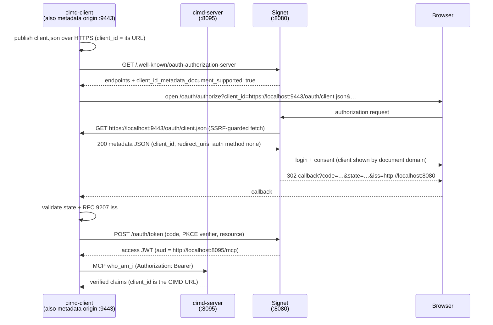

In the [2026-07-28 Authorization spec announcement][mcp-announce], MCP shipped a batch of authorization-hardening changes in one go: **RFC 9207 issuer validation is now mandatory**, client credentials are bound to the issuer that minted them (no reuse across authorization servers), and — the headline item — **Dynamic Client Registration (DCR) is formally deprecated in favor of CIMD (Client ID Metadata Documents)**. DCR stays functional for backward compatibility for at least 12 months, but the direction is set: a future version will remove it.

Half a year ago I wrote [Introduction to OAuth Client ID Metadata Document (CIMD)][prev-cimd], covering the three pain points CIMD solves (pre-registration doesn't scale, DCR's unbounded client database and self-asserted trust problem, and MCP's "no pre-existing relationship" scenario). That was the concept piece; now that the spec has put CIMD front and center, it's time for the hands-on companion — **running a complete CIMD authorization flow end to end, watching an HTTPS URL travel all the way into the `client_id` claim of an access token**.

This post takes apart the [`03-oauth-mcp/cimd` sample from go-training/mcp-workshop][sample]: two runnable Go programs (`cimd-client`, `cimd-server`) with [Signet][signet] as the authorization server — from minting a local certificate with mkcert, publishing the client metadata document, Authorization Code + PKCE, RFC 9207 `iss` validation, to finally calling the MCP `who_am_i` tool with a Bearer token. And as a bonus: **swapping the OAuth client for Claude Code itself**, logging in against the CIMD URL with `claude mcp add`.

[mcp-announce]: https://blog.modelcontextprotocol.io/posts/2026-07-28/
[prev-cimd]: https://blog.wu-boy.com/2026/02/oauth-client-id-metadata-document/
[sample]: https://github.com/go-training/mcp-workshop/tree/main/03-oauth-mcp/cimd
[signet]: https://github.com/go-signet
[signet-k8s]: https://blog.wu-boy.com/2026/04/kubelogin-signet-k3s-tutorial-en/
[signet-kong]: https://blog.wu-boy.com/2026/06/kong-signet-mcp-oauth-en/

<!--more-->

> If you haven't read the concept piece yet, spend five minutes on [Introduction to OAuth Client ID Metadata Document (CIMD)][prev-cimd] first — this post won't repeat the "why CIMD" story and jumps straight into "how to run it". As for the RFC 9207 `iss` validation that shows up throughout, the theory is in [When an MCP Client Trusts Multiple Authorization Servers: Stopping Mix-Up Attacks with RFC 9207][prev-9207] and the live attack demo in [Taking the MCP Mix-Up Attack Apart][prev-demo] — those two posts are also the backstory for why this announcement made `iss` mandatory.

[prev-9207]: https://blog.wu-boy.com/2026/07/rfc9207-issuer-identification-mcp-mixup-en/
[prev-demo]: https://blog.wu-boy.com/2026/07/rfc9207-mcp-mixup-attack-demo-en/

## 1. What Actually Changed on 2026-07-28

The announcement's points relevant to this post, in one table:

| Change | What it says | What it means for you |
| --- | --- | --- |
| **DCR formally deprecated** | Explicitly "deprecated in favor of CIMD"; at least a 12-month compatibility window; removed in a future version | New projects go straight to CIMD; existing DCR flows should start planning migration |
| **CIMD becomes the standard** | The client uses an HTTPS URL as its `client_id`; the AS fetches the JSON document at that URL on the fly to complete "registration" | No more registering with every AS, no client secrets to manage |
| **RFC 9207 mandatory** | The AS must return `iss` on the authorization response; the client must validate it before redeeming the code | Closes the [mix-up attack][prev-9207] hole; the check is the client's job |
| **Issuer-bound credentials** | Client credentials are bound to the AS that minted them; no reuse across authorization servers | One credential is valid against exactly one AS |

One naming clarification up front — **CIMD is not CIDR**. CIMD is a public HTTPS JSON document describing an OAuth client; CIDR (the `10.0.0.0/8` kind) only shows up later, in the SSRF-guard part of the story on the AS side.

CIMD's core idea in one sentence: **the client no longer "registers with the AS" — it "publishes its own identity"**. The client hosts a metadata JSON document at an HTTPS URL it controls; that URL *is* the `client_id`. The AS fetches the document while handling the authorization request and materializes the client from it. No registration API, no client database, no client secret.

## 2. The Three Roles in the Sample

The sample ships three Go programs plus an external Signet (the same one used by the [RFC 9207 attack demo][prev-demo]):

| Program | Role | Default address |
| --- | --- | --- |
| `cimd-client/` | **Plays two roles at once**: HTTPS metadata origin (serving the document) + MCP OAuth client (RFC 8414 discovery, Auth Code + S256 PKCE, RFC 9207 `iss` validation, Bearer-authenticated `who_am_i`) | origin `:9443`, callback `:8085` |
| `cimd-server/` | An ordinary MCP resource server (RFC 9728 protected resource metadata + local JWKS verification of Signet-issued JWTs) | `:8095` |
| `claude-code/` | A **standalone metadata origin** for testing with Claude Code (section 8) | `:9443` |
| Signet (external) | The authorization server that fetches and validates the metadata document | `:8080` |

`cimd-server` has a design choice worth pausing on: **it deliberately contains nothing CIMD-specific**. A resource server never sees the metadata document — it only verifies the resulting access token (issuer, audience, signature). CIMD is strictly between the client and the AS; the cleaner that boundary, the less your resource server has to change when registration mechanisms evolve.

The full flow:



Look at the `A->>C` step in the middle: **the direction is reversed**. In classic OAuth the AS never initiates a connection to the client; with CIMD, the AS turns around mid-authorization-request and fetches the document the client published. That one step is the soul of the mechanism — and the origin of every rule that follows, from SSRF protection to the HTTPS mandate.

## 3. Why Only the Metadata URL Needs HTTPS

Almost everything in the sample runs over plain HTTP — **except the metadata document URL itself**:

| Component | Scheme | Why |
| --- | --- | --- |
| Signet issuer (`localhost:8080`) | HTTP OK | dev deployment |
| MCP resource server (`localhost:8095`) | HTTP OK | dev deployment |
| OAuth callback (`127.0.0.1:8085`) | HTTP OK | loopback redirect URIs may be HTTP even under strict mode |
| **CIMD document URL (= `client_id`)** | **HTTPS required** | Signet's `IsCIMDClientID` predicate only recognizes `https` URLs — **no development-mode exception**. An `http://…/client.json` client_id is treated as an unknown regular client and fails with `unauthorized_client` |

Why no backdoor here? Because **the HTTPS domain is CIMD's trust anchor**. The only evidence of "who this client is" in the entire mechanism is "who controls this HTTPS URL"; allowing HTTP would let any man-in-the-middle claim to be any client, severing the trust chain at its root.

For local development, [mkcert][mkcert] solves it in two lines — it installs a local CA into the system trust store, which is exactly what Signet's fetcher (and the client's own preflight check) uses to verify TLS:

```bash
mkcert -install          # once: create + trust the local CA
mkcert localhost         # produces localhost.pem / localhost-key.pem
```

`-cert` / `-key` are resolved relative to the working directory, so run these commands from wherever you'll run `go run` later (the repo root). `.gitignore` already covers `*.pem`, but never commit the key.

[mkcert]: https://github.com/FiloSottile/mkcert

## 4. Signet Configuration: Three Environment Variables

Run a [Signet][signet] at `http://localhost:8080` — my own OAuth2 / OIDC authorization server (**not open source at the moment**), the same one used in the [kubelogin × k3s][signet-k8s] and [Kong MCP unified gateway][signet-kong] tutorials. The three environment variables below are Signet implementation details, but the three security decisions behind them (capability advertisement, resource allowlist, SSRF protection) apply to any authorization server implementing CIMD:

```bash
CIMD_ENABLED=true
CIMD_ALLOWED_RESOURCES=http://localhost:8095/mcp
CIMD_ALLOW_PRIVATE_NETWORKS=true   # loopback-only dev testing; never in production
```

One by one, because each maps to a security decision:

- **`CIMD_ENABLED`** — off by default. When off, Signet doesn't advertise `client_id_metadata_document_supported` in its metadata, and the client aborts early — before the browser ever opens. That's capability declaration by design: the client discovers first, confirms AS support, then starts the flow.
- **`CIMD_ALLOWED_RESOURCES`** — the RFC 8707 `resource` a CIMD client requests must appear in this list **byte-for-byte** — **a trailing slash counts**. Anything not on the list fails the authorize request with `invalid_target`. This is the AS-side allowlist controlling which resources an anonymous client can obtain tokens for.
- **`CIMD_ALLOW_PRIVATE_NETWORKS`** — Signet's **SSRF guard** rejects loopback and private-network addresses at dial time by default. Think about it: `client_id` is a URL an attacker can choose freely, and the AS will fetch it — without this guard, an attacker could point `client_id` at anything on your internal network (`https://169.254.169.254/…`, internal APIs…) and have the AS make requests on their behalf. This flag disables the guard purely so Signet can fetch `https://localhost:9443/…`; **only ever set it in isolated local development**.

Once configured, verify the capability is actually on:

```bash
curl -s http://localhost:8080/.well-known/oauth-authorization-server \
  | jq '.client_id_metadata_document_supported'   # must be true
```

## 5. Quick Start: Two Terminals

Both commands run from the repo root (where mkcert wrote the pems):

```bash
# terminal 1 — MCP resource server
go run ./03-oauth-mcp/cimd/cimd-server \
  -auth-server http://localhost:8080 \
  -resource    http://localhost:8095/mcp

# terminal 2 — CIMD client
go run ./03-oauth-mcp/cimd/cimd-client \
  -auth-server http://localhost:8080 \
  -mcp-url     http://localhost:8095/mcp \
  -cimd-url    https://localhost:9443/oauth/client.json \
  -cert localhost.pem -key localhost-key.pem
```

Pause on that terminal-2 command and compare it to any OAuth sample you've run before: **no `-client_id` flag, no registration step, no client secret**. The client publishes this document at `https://localhost:9443/oauth/client.json`, and that URL _is_ the client's identity:

```json
{
  "client_id": "https://localhost:9443/oauth/client.json",
  "client_name": "CIMD Workshop Client",
  "redirect_uris": ["http://127.0.0.1:8085/callback"],
  "token_endpoint_auth_method": "none",
  "grant_types": ["authorization_code", "refresh_token"],
  "scope": "openid profile email"
}
```

The browser opens Signet's login and consent page automatically; after consent, the client completes the token exchange and calls `who_am_i` — the output shows the token's verified `client_id` is exactly that CIMD URL.

## 6. The Rules the Document Must Follow

The JSON looks unremarkable, but Signet's validation is anything but lenient. The rules (the sample client's `validateCIMDURL` and its startup preflight self-check mirror the same set, so mistakes explode here with a readable error instead of surfacing as an opaque `unauthorized_client` after a full browser round-trip):

1. **`client_id` must be byte-identical to the URL the document is fetched from.** One character off and the document is no longer "this URL's self-description".
2. **URL shape**: HTTPS, a hostname, a path more specific than `/`, no `.` / `..` segments, no fragment, no userinfo.
3. **Served directly with `200`** — no redirects, no auth. Signet caps the document at 64 KiB (the draft recommends < 5 KB).
4. **`token_endpoint_auth_method` must be empty or `none`** — a CIMD client is always a public client. It makes sense once you think about it: there is no step in the flow where a secret could be exchanged safely, so PKCE (S256) is the only proof at the token endpoint.
5. **1–10 `redirect_uris`, exact-match comparison.** So the callback listener uses a fixed port, never `:0` — there is no registration step where a new port could be announced.
6. **Scopes get intersected**: Signet intersects the declared `scope` with its user-safe set (`openid profile email offline_access`); custom scopes like `mcp:tools` are **silently dropped** in the current implementation.

In code, the URL shape rules look like this (`cimd-client/cimd.go`, excerpt):

```go
// validateCIMDURL mirrors Signet's IsCIMDClientID predicate so a bad URL fails
// here with a readable error instead of an opaque unauthorized_client after
// the browser round-trip.
func validateCIMDURL(raw string) error {
	if strings.Contains(raw, "#") {
		return errors.New("must not contain a fragment")
	}
	u, err := url.Parse(raw)
	if err != nil {
		return fmt.Errorf("not a valid URL: %w", err)
	}
	if !strings.EqualFold(u.Scheme, "https") {
		return fmt.Errorf("scheme %q is not https — Signet only treats https URLs as "+
			"CIMD client_ids, with no development-mode exception; use mkcert for "+
			"local TLS", u.Scheme)
	}
	if u.Hostname() == "" {
		return errors.New("missing hostname")
	}
	if u.Path == "" || u.Path == "/" {
		return errors.New("path must be more specific than \"/\"")
	}
	// …no "." / ".." path segments, no userinfo
	return nil
}
```

And when building the document, `client_id` is always set to the document URL itself, structurally ruling out the typo class of errors:

```go
doc := clientMetadata{
	ClientID:     cimdURL, // must be byte-identical to the fetched URL
	ClientName:   name,
	RedirectURIs: []string{redirectURI},
	// CIMD clients are always public: there is no registration step at
	// which a secret could be exchanged, so "none" is the only valid value.
	TokenEndpointAuthMethod: "none",
	GrantTypes:              []string{"authorization_code", "refresh_token"},
	Scope:                   strings.Join(scopes, " "),
}
```

After startup the client also runs a **preflight self-check**: using the same system trust store Signet uses, it fetches its own freshly published URL and requires a direct 200, no redirects, and a response **byte-for-byte equal to the document it just built**. Comparing the whole document rather than just `client_id` also pins redirect_uris and scope — if a cache or another process is answering that URL, it gets caught right here, instead of after Signet has silently resolved a different client.

## 7. Reading the Flow from the Logs (RFC 9207 Included)

Once it's running, watch for these log lines in order — each one maps to a security mechanism:

1. client: `client metadata document published` — preflight passed (direct 200, byte-identical `client_id`).
2. client: `opening browser for authorization — Signet will now fetch the metadata document to resolve the client` — a reminder that the AS is about to fetch in reverse.
3. **Signet's consent page identifies the client by the document's domain (`localhost`), not the self-asserted `client_name`** — anyone can type any name; a name proves nothing. The domain is the HTTPS trust anchor, and this is the CIMD trust model showing up directly in the UI.
4. client: `iss OK` — **the RFC 9207 issuer check passed before the code was sent to the token endpoint**.
5. server: `audience verified` — the JWT's `aud` is the MCP resource, bound by the RFC 8707 `resource` parameter; the token is useless against any other resource server.
6. client: the `who_am_i` structured output shows `client_id` = `https://localhost:9443/oauth/client.json` — **the CIMD URL made it all the way into the issued token**.

Step 4 deserves a closer look. The announcement made RFC 9207 mandatory, and the check is **the client's responsibility** — the sample's implementation covers all four branches analyzed in [the attack demo post][prev-demo]:

```go
// validateIssuerResponse is the RFC 9207 client check: the iss returned on the
// authorization response must match the issuer discovered from AS metadata,
// byte-for-byte.
func validateIssuerResponse(iss, expectedIssuer string, issParameterSupported bool) error {
	if issParameterSupported {
		if iss == "" {
			return fmt.Errorf(
				"issuer identification required but authorization response carried no iss "+
					"(expected %q)", expectedIssuer)
		}
		if iss != expectedIssuer {
			return fmt.Errorf(
				"issuer mismatch: got %q want %q — aborting", iss, expectedIssuer)
		}
		return nil
	}
	// When the AS does not advertise RFC 9207 support, a conforming AS must
	// not send iss; if one appears, the response is not trustworthy.
	if iss != "" {
		return fmt.Errorf(
			"authorization response carried iss %q but the AS does not advertise "+
				"issuer identification support — aborting", iss)
	}
	return nil
}
```

Signet advertises `authorization_response_iss_parameter_supported`, so in this sample a *missing* `iss` is also a failure — not "validate if present, shrug if absent".

## 8. Swapping the OAuth Client for Claude Code

The `cimd-client` above is a hand-rolled teaching implementation; in the real world you'd rather have your actual MCP client — say, **Claude Code** — walk the CIMD path directly. Claude Code supports URL-shaped `client_id`s: you hand it a CIMD URL, it passes that URL as-is through the OAuth flow, and Signet fetches the document to resolve the client — exactly the same machinery as before.

The one gap: **a CLI cannot host an HTTPS origin of its own**. In `cimd-client` the OAuth client and the metadata origin are the same process; with Claude Code the roles split, and the sample's `claude-code/` folder is the stand-in origin — one HTTPS listener, one JSON document, nothing else:

| Role | cimd sample | Claude Code test |
| --- | --- | --- |
| OAuth client (browser flow, PKCE, token) | `cimd-client` | **Claude Code** |
| Metadata origin (`https://localhost:9443/oauth/client.json`) | `cimd-client` (embedded) | **the `claude-code/` binary** |
| MCP resource server | `cimd-server` | `cimd-server` (unchanged) |
| Authorization server | Signet | Signet (unchanged) |

Prerequisites are the same as sections 3 and 4 (mkcert certificate + the same Signet environment variables). To run:

```bash
# terminal 1 — MCP resource server (identical to section 5)
go run ./03-oauth-mcp/cimd/cimd-server \
  -auth-server http://localhost:8080 \
  -resource    http://localhost:8095/mcp

# terminal 2 — standalone metadata origin
go run ./03-oauth-mcp/cimd/claude-code \
  -cert localhost.pem -key localhost-key.pem
```

Then register the MCP server with Claude Code, pointing its `client_id` at the published document:

```bash
claude mcp add --transport http \
  --client-id https://localhost:9443/oauth/client.json \
  --callback-port 8085 \
  cimd-server http://localhost:8095/mcp
```

Or the equivalent `.mcp.json`:

```json
{
  "mcpServers": {
    "cimd-server": {
      "type": "http",
      "url": "http://localhost:8095/mcp",
      "oauth": {
        "clientId": "https://localhost:9443/oauth/client.json",
        "callbackPort": 8085
      }
    }
  }
}
```

Authenticate — inside a Claude Code session via `/mcp`, pick `cimd-server` → Authenticate, or straight from the shell:

```bash
claude mcp login cimd-server
```

The browser opens Signet's consent page, again identifying the client by the document's domain; after consent, Claude Code exchanges the code with PKCE S256 (no client secret — the document pins `token_endpoint_auth_method` to `none`), calls `who_am_i`, and the returned claims show `client_id` = `https://localhost:9443/oauth/client.json`.

Two Claude Code-specific gotchas:

- **The callback port must be fixed.** By default Claude Code picks a random port for its OAuth callback, but CIMD redirect URIs are compared by exact match and there's no registration step where a new port could be announced — a random port will never match the document. So both sides pin `8085`: Claude Code via `--callback-port 8085` (or `oauth.callbackPort` in `.mcp.json`), and the origin's `-redirect-uris` defaults cover both `http://localhost:8085/callback` and `http://127.0.0.1:8085/callback` loopback spellings. Note `8085` is also `cimd-client`'s default callback port — stop `cimd-client` before testing, or they'll fight over the port.
- **The origin must stay running.** Signet re-fetches the `client_id` URL on **every** authorization request — the document *is* the registration, and the registration is checked live. Stop the origin after the first successful login and the next re-auth fails.

## 9. Troubleshooting

The sample README's error table, condensed — all of these are either ones I hit myself or ones the design guarantees you'll hit:

| Symptom | Likely cause | Check |
| --- | --- | --- |
| client aborts early: `does not advertise client_id_metadata_document_supported` | CIMD disabled on Signet | `CIMD_ENABLED=true`, restart Signet |
| `metadata self-check failed` + TLS error | certificate not trusted | `mkcert -install`; cert covers the `-cimd-url` hostname |
| `unauthorized_client` at authorize | `client_id` not recognized as a CIMD URL | scheme must be `https`, path more specific than `/` |
| `invalid_client` during authorization | Signet's fetch failed | Signet `component=cimd` logs; loopback origins need `CIMD_ALLOW_PRIVATE_NETWORKS=true`; direct 200; byte-identical `client_id` |
| `invalid_target` | resource not allowlisted | `CIMD_ALLOWED_RESOURCES` contains `-resource` byte-for-byte (trailing slash counts) |
| scopes went missing | custom scopes dropped by intersection | only `openid profile email offline_access` survive for CIMD clients |
| token obtained but cimd-server returns 401 | audience / issuer mismatch | `-resource` matches on both sides; both point at the same Signet |
| (Claude Code) redirect mismatch | random callback port | `--callback-port 8085` aligned with the origin's `-redirect-uris` |
| (Claude Code) first login works, later fails | origin was stopped | Signet re-fetches the document on every authorization — keep the origin running |

You can also verify the rules without starting any server — the sample ships tests covering the CIMD URL shape rules, the byte-exact `client_id` binding, the origin handler's response contract, and every branch of the RFC 9207 `iss` validation:

```bash
go test ./03-oauth-mcp/cimd/...
```

## Wrapping Up

Map what you just ran back onto the announcement and you'll find this sample is essentially the 2026-07-28 spec made concrete:

- **"DCR deprecated, CIMD takes over"** on the command line looks like that startup command with **no `-client_id`, no registration step, no client secret** — the `client_id` is an HTTPS URL you control, fetched and validated by the AS on the fly. The registration wall is gone.
- **The trust anchor moves from "a registration record" to "an HTTPS domain"**: Signet's consent page identifies the client by document domain rather than self-asserted `client_name`, redirect_uris are pinned inside the document, and public client + PKCE replaces the secret.
- **RFC 9207 is the client's homework**: the `iss` check gates the code before it's ever sent, and "the AS advertises support but sent no iss" is also a failure — this is precisely the conclusion of the two mix-up posts, now written into the spec.
- **The AS pays with an SSRF surface**: the AS fetches a URL the client chose, so Signet's SSRF guard (rejecting loopback / private networks) is a necessary production defense, and `CIMD_ALLOW_PRIVATE_NETWORKS=true` belongs to local experiments only.

If you operate an MCP service still on DCR, the 12-month compatibility window is for migrating, not for waiting. The minimal migration path is genuinely short: pick a stable HTTPS URL for your client, host a few hundred bytes of JSON there, switch `client_id` to that URL — the six rules in section 6 are your acceptance checklist. **Clone the sample and run it once with your own hands, then log in against it from Claude Code** — your intuition for "the URL is the identity" will be more solid than ten readings of the draft.

Full code and runbook: <https://github.com/go-training/mcp-workshop/tree/main/03-oauth-mcp/cimd>

## References

- [MCP announcement: 2026-07-28 Authorization changes][mcp-announce]
- [draft-ietf-oauth-client-id-metadata-document](https://datatracker.ietf.org/doc/draft-ietf-oauth-client-id-metadata-document/)
- [RFC 9207 — OAuth 2.0 Authorization Server Issuer Identification](https://datatracker.ietf.org/doc/html/rfc9207)
- [RFC 9728 — OAuth 2.0 Protected Resource Metadata](https://datatracker.ietf.org/doc/html/rfc9728)
- [RFC 8707 — Resource Indicators for OAuth 2.0](https://datatracker.ietf.org/doc/html/rfc8707)
- [RFC 7636 — Proof Key for Code Exchange](https://datatracker.ietf.org/doc/html/rfc7636)
- Series: [CIMD concepts][prev-cimd], [RFC 9207 theory][prev-9207], [Mix-Up attack demo][prev-demo]
- [Signet — OAuth2 / OIDC Authorization Server][signet]
- Signet tutorials: [kubelogin × Signet × k3s][signet-k8s], [Kong × Signet unified enterprise OAuth2 gateway][signet-kong]
