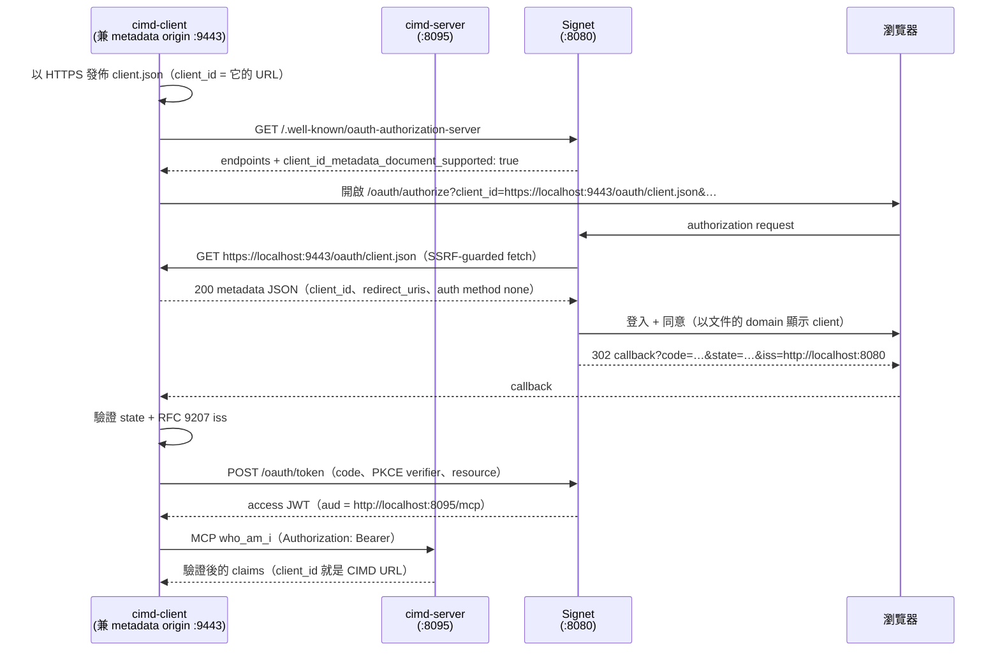

MCP 官方在 [2026-07-28 版的 Authorization 規範公告][mcp-announce]中，一口氣做了幾件授權強化（authorization hardening）的大事：**RFC 9207 issuer 驗證成為必須**、client 憑證綁定發行它的 issuer 不得跨 AS 重用，以及最重要的一項——**Dynamic Client Registration（DCR）正式棄用（deprecated），由 CIMD（Client ID Metadata Documents）接手成為標準做法**。DCR 還會為了向下相容保留至少 12 個月，但方向已經定了：未來版本會把它移除。

半年前我寫過一篇 [《OAuth Client ID Metadata Document (CIMD) 簡介》][prev-cimd]，把 CIMD 要解決的三個痛點（預先註冊不可行、DCR 的無界資料庫與自我宣告信任問題、MCP「毫無前置關係」的場景）講完了。那是概念篇；現在官方直接把 CIMD 推上正桌，是時候補上實戰篇——**親手把一條完整的 CIMD 授權流程跑起來，看著一個 HTTPS URL 一路變成 access token 裡的 `client_id`**。

這篇拆解的是 [go-training/mcp-workshop 的 `03-oauth-mcp/cimd` 範例][sample]：兩個能跑的 Go 程式（`cimd-client`、`cimd-server`）搭配 [Signet][signet] 當授權伺服器，從 mkcert 簽本機憑證、發佈 client metadata document、Authorization Code + PKCE、RFC 9207 `iss` 驗證，到最後帶著 Bearer token 呼叫 MCP 的 `who_am_i` 工具。最後再加碼：**把 OAuth client 換成 Claude Code 本人**，用 `claude mcp add` 直接對著 CIMD URL 登入。

[mcp-announce]: https://blog.modelcontextprotocol.io/posts/2026-07-28/
[prev-cimd]: https://blog.wu-boy.com/2026/02/oauth-client-id-metadata-document-zh-tw/
[sample]: https://github.com/go-training/mcp-workshop/tree/main/03-oauth-mcp/cimd
[signet]: https://github.com/go-signet
[signet-k8s]: https://blog.wu-boy.com/2026/04/kubelogin-signet-k3s-tutorial-zh-tw/
[signet-kong]: https://blog.wu-boy.com/2026/06/kong-signet-mcp-oauth-zh-tw/

<!--more-->

> 如果你還沒讀過概念篇，建議先花五分鐘看 [《OAuth Client ID Metadata Document (CIMD) 簡介》][prev-cimd]——本文不再重複「為什麼需要 CIMD」，直接進入「怎麼跑起來」。至於文中反覆出現的 RFC 9207 `iss` 驗證，原理在 [《當 MCP Client 同時信任多個授權伺服器：用 RFC 9207 堵住 Mix-Up 攻擊》][prev-9207]，攻擊實演在 [《動手拆解 MCP Mix-Up 攻擊》][prev-demo]，這兩篇也是這次官方公告把 `iss` 列為必須的背景故事。

[prev-9207]: https://blog.wu-boy.com/2026/07/rfc9207-issuer-identification-mcp-mixup-zh-tw/
[prev-demo]: https://blog.wu-boy.com/2026/07/rfc9207-mcp-mixup-attack-demo-zh-tw/

## 一、官方 2026-07-28 到底改了什麼

先把公告裡跟本文有關的重點整理成一張表：

| 變更 | 內容 | 對你的影響 |
| --- | --- | --- |
| **DCR 正式棄用** | 明文「deprecated in favor of CIMD」，保留至少 12 個月相容期，未來版本移除 | 新專案直接上 CIMD；既有 DCR 流程開始規劃遷移 |
| **CIMD 成為標準** | client 以 HTTPS URL 作為 `client_id`，AS 即時抓取該 URL 上的 JSON 文件完成「註冊」 | 不用再對每台 AS 註冊、不用管理 client secret |
| **RFC 9207 必須** | AS 必須在授權回應帶 `iss`，client 必須在兌換 code 前驗證 | 堵住 [Mix-Up 攻擊][prev-9207]；client 端要自己做這個比對 |
| **憑證綁定 issuer** | client credentials 綁定發行它的 AS，不得跨 AS 重用 | 一份憑證只對一台 AS 有效 |

這裡有個容易搞混的名詞先澄清——**CIMD 不是 CIDR**。CIMD 是一份放在公開 HTTPS 上、描述 OAuth client 的 JSON 文件；CIDR（`10.0.0.0/8` 那個）只會在後面講 AS 端 SSRF 防護時出現。

CIMD 的核心概念一句話：**client 不再「去 AS 註冊」，而是「自己發佈身分」**。client 把一份 metadata JSON 放在自己控制的 HTTPS URL 上，這個 URL 本身就是 `client_id`；AS 在處理授權請求時即時抓取這份文件，據此「具現化（materialize）」這個 client。沒有註冊 API、沒有 client database、沒有 client secret。

## 二、範例的三個角色

範例裡有三個 Go 程式加一台外部的 Signet（跟之前 [RFC 9207 攻擊 demo][prev-demo] 用的是同一台）：

| 程式 | 角色 | 預設位址 |
| --- | --- | --- |
| `cimd-client/` | **一人分飾兩角**：HTTPS metadata origin（發佈文件）+ MCP OAuth client（RFC 8414 探索、Auth Code + S256 PKCE、RFC 9207 `iss` 驗證、Bearer 呼叫 `who_am_i`） | origin `:9443`、callback `:8085` |
| `cimd-server/` | 普通的 MCP resource server（RFC 9728 protected resource metadata + 本地 JWKS 驗證 Signet 簽的 JWT） | `:8095` |
| `claude-code/` | 給 Claude Code 實測用的**獨立 metadata origin**（第八節） | `:9443` |
| Signet（外部） | 授權伺服器，負責抓取並驗證 metadata document | `:8080` |

`cimd-server` 有個值得停下來想一秒的設計：**它刻意不含任何 CIMD 相關程式碼**。Resource server 從頭到尾不會看到 metadata document——它只負責驗證最後拿到的 access token（issuer、audience、簽章）。CIMD 是 client 與 AS 之間的事，這個邊界劃得越乾淨，你的 resource server 就越不用跟著註冊機制改版。

整條流程長這樣：



注意中段那一步 `A->>C`：**方向反過來了**。傳統 OAuth 裡 AS 從不主動連 client；CIMD 裡 AS 會在授權請求處理到一半時，回頭抓 client 發佈的文件。這一步是整個機制的靈魂，也是後面 SSRF 防護、HTTPS 強制等所有規則的由來。

## 三、為什麼只有 metadata URL 需要 HTTPS

範例幾乎全程跑 HTTP——**除了 metadata document 的 URL 本身**：

| 元件 | Scheme | 原因 |
| --- | --- | --- |
| Signet issuer（`localhost:8080`） | HTTP 可 | 開發環境 |
| MCP resource server（`localhost:8095`） | HTTP 可 | 開發環境 |
| OAuth callback（`127.0.0.1:8085`） | HTTP 可 | loopback redirect URI 即使在嚴格模式下也允許 HTTP |
| **CIMD 文件 URL（= `client_id`）** | **必須 HTTPS** | Signet 的 `IsCIMDClientID` 判斷式只認 `https` URL，**沒有開發模式例外**。`http://…/client.json` 會被當成不認識的一般 client，直接吐 `unauthorized_client` |

為什麼這裡不留後門？因為 **HTTPS domain 就是 CIMD 的信任錨（trust anchor）**。整套機制裡「client 是誰」的唯一證據，就是「誰控制了這個 HTTPS URL」；允許 HTTP 等於允許任何中間人宣稱自己是任何 client，信任鏈從根就斷了。

本機開發用 [mkcert][mkcert] 兩行解決——它會建一個本機 CA 裝進系統信任庫，而 Signet 的 fetcher（以及 client 自己的 preflight 檢查）驗 TLS 用的正是系統信任庫：

```bash
mkcert -install          # 一次性：建立並信任本機 CA
mkcert localhost         # 產出 localhost.pem / localhost-key.pem
```

`-cert` / `-key` 是相對工作目錄解析的，所以請在你等一下跑 `go run` 的目錄（repo root）執行上面的指令。`.gitignore` 已涵蓋 `*.pem`，但 key 永遠不要 commit。

[mkcert]: https://github.com/FiloSottile/mkcert

## 四、Signet 端設定：三個環境變數

在 `http://localhost:8080` 跑一台 [Signet][signet]——我自己開發的 OAuth2 / OIDC 授權伺服器（**目前尚未開源**），之前 [kubelogin × k3s][signet-k8s] 與 [Kong MCP 統一入口][signet-kong] 兩篇教學用的是同一套。以下三個環境變數是 Signet 的實作細節，但背後的三個安全決策（能力廣告、resource 白名單、SSRF 防護）適用於任何實作 CIMD 的授權伺服器：

```bash
CIMD_ENABLED=true
CIMD_ALLOWED_RESOURCES=http://localhost:8095/mcp
CIMD_ALLOW_PRIVATE_NETWORKS=true   # 只限本機測試；生產環境絕對不要開
```

逐一解釋，因為每一個都對應一個安全決策：

- **`CIMD_ENABLED`** — 預設關閉。關閉時 Signet 不會在 metadata 廣告 `client_id_metadata_document_supported`，client 會在瀏覽器打開前就提早中止。這是「能力聲明」的設計：client 先探索、確認 AS 支援，才開始流程。
- **`CIMD_ALLOWED_RESOURCES`** — CIMD client 用 RFC 8707 `resource` 參數請求的資源，必須**逐位元組（byte-for-byte）**出現在這份清單裡——**結尾斜線也算**。不在清單上，authorize 請求直接失敗 `invalid_target`。這是 AS 端對「匿名 client 能拿到哪些資源的 token」的白名單控制。
- **`CIMD_ALLOW_PRIVATE_NETWORKS`** — Signet 的 **SSRF guard** 預設會在撥號（dial）階段就拒絕 loopback 與私有網段位址。想想看：`client_id` 是攻擊者可以任意指定的 URL，而 AS 會去抓它——沒有這道防護，攻擊者就能把 `client_id` 指向你內網的任何服務（`https://169.254.169.254/…`、內部 API…），讓 AS 替他發請求。這個旗標把防護關掉，純粹是為了讓 Signet 抓得到 `https://localhost:9443/…`，**只能在隔離的本機開發環境使用**。

設定完，先驗證能力真的開了：

```bash
curl -s http://localhost:8080/.well-known/oauth-authorization-server \
  | jq '.client_id_metadata_document_supported'   # 必須是 true
```

## 五、Quick start：兩個 terminal 跑起來

兩個指令都在 repo root 執行（mkcert 的 pem 檔在那裡）：

```bash
# terminal 1 — MCP resource server
go run ./03-oauth-mcp/cimd/cimd-server \
  -auth-server http://localhost:8080 \
  -resource    http://localhost:8095/mcp

# terminal 2 — CIMD client
go run ./03-oauth-mcp/cimd/cimd-client \
  -auth-server http://localhost:8080 \
  -mcp-url     http://localhost:8095/mcp \
  -cimd-url    https://localhost:9443/oauth/client.json \
  -cert localhost.pem -key localhost-key.pem
```

停下來看一眼 terminal 2 那條指令，然後對比你以前跑過的任何 OAuth 範例：**沒有 `-client_id` 旗標、沒有註冊步驟、沒有 client secret**。client 發佈這份文件在 `https://localhost:9443/oauth/client.json`，而那個 URL _就是_ client 的身分：

```json
{
  "client_id": "https://localhost:9443/oauth/client.json",
  "client_name": "CIMD Workshop Client",
  "redirect_uris": ["http://127.0.0.1:8085/callback"],
  "token_endpoint_auth_method": "none",
  "grant_types": ["authorization_code", "refresh_token"],
  "scope": "openid profile email"
}
```

瀏覽器會自動打開 Signet 的登入與同意畫面；同意後 client 完成 token 交換，最後呼叫 `who_am_i`，你會在輸出裡看到 token 驗證出來的 `client_id` 就是那個 CIMD URL。

## 六、文件必須遵守的規則

這份 JSON 看起來平凡，但 Signet 對它的驗證一點都不客氣。規則如下（範例 client 的 `validateCIMDURL` 與啟動時的 preflight 自我檢查也鏡射了同一套，讓錯誤在瀏覽器打開前就用可讀的訊息炸出來，而不是繞完一圈瀏覽器才收到一句 `unauthorized_client`）：

1. **`client_id` 必須與文件被抓取的 URL 逐位元組相同**。差一個字元，這份文件就不是「這個 URL 的自我描述」。
2. **URL 形狀**：必須是 HTTPS、有 hostname、路徑比 `/` 更具體、不含 `.` / `..` 路徑段、不含 fragment、不含 userinfo。
3. **直接以 `200` 回應**——不許 redirect、不許要求認證。Signet 對文件大小上限 64 KiB（draft 建議 < 5 KB）。
4. **`token_endpoint_auth_method` 必須是空或 `none`**——CIMD client 永遠是 public client。想想就合理：整個流程沒有任何一步可以安全地交換 secret，所以 token endpoint 的唯一證明就是 PKCE（S256）。
5. **1–10 個 `redirect_uris`，精確比對**。所以 callback listener 要用固定 port，不能用 `:0` 隨機挑——沒有註冊步驟可以事後宣告新 port。
6. **scope 會被交集**：Signet 把文件宣告的 scope 與它的 user-safe 集合（`openid profile email offline_access`）取交集，自訂 scope（例如 `mcp:tools`）在目前實作會被**默默丟掉**。

對應到程式碼，URL 形狀規則長這樣（`cimd-client/cimd.go`，節錄）：

```go
// validateCIMDURL mirrors Signet's IsCIMDClientID predicate so a bad URL fails
// here with a readable error instead of an opaque unauthorized_client after
// the browser round-trip.
func validateCIMDURL(raw string) error {
	if strings.Contains(raw, "#") {
		return errors.New("must not contain a fragment")
	}
	u, err := url.Parse(raw)
	if err != nil {
		return fmt.Errorf("not a valid URL: %w", err)
	}
	if !strings.EqualFold(u.Scheme, "https") {
		return fmt.Errorf("scheme %q is not https — Signet only treats https URLs as "+
			"CIMD client_ids, with no development-mode exception; use mkcert for "+
			"local TLS", u.Scheme)
	}
	if u.Hostname() == "" {
		return errors.New("missing hostname")
	}
	if u.Path == "" || u.Path == "/" {
		return errors.New("path must be more specific than \"/\"")
	}
	// …不含 "." / ".." 路徑段、不含 userinfo
	return nil
}
```

而產生文件時，`client_id` 一律直接設成文件 URL 本身，從結構上杜絕「打錯字」這一類錯誤：

```go
doc := clientMetadata{
	ClientID:     cimdURL, // 必須與被抓取的 URL 逐位元組相同
	ClientName:   name,
	RedirectURIs: []string{redirectURI},
	// CIMD client 永遠是 public client：流程中沒有任何一步能交換 secret，
	// 所以 "none" 是唯一合法值。
	TokenEndpointAuthMethod: "none",
	GrantTypes:              []string{"authorization_code", "refresh_token"},
	Scope:                   strings.Join(scopes, " "),
}
```

client 啟動後還會做一次 **preflight 自我檢查**：用跟 Signet 一樣的系統信任庫，對自己剛發佈的 URL 抓一次，要求直接 200、不許 redirect、**回應內容與剛建好的文件完整位元組相等**。比對整份文件而不是只比 `client_id`，順便把 redirect_uris 和 scope 也釘住——如果有快取或另一個程序在回應這個 URL，會在這裡就被抓到，而不是等 Signet 解析出「另一個 client」之後才莫名其妙。

## 七、從 log 看懂整條流程（含 RFC 9207）

跑起來之後，依序注意這幾行 log，每一行都對應一個安全機制：

1. client：`client metadata document published` — preflight 通過（直接 200、`client_id` 逐位元組相同）。
2. client：`opening browser for authorization — Signet will now fetch the metadata document to resolve the client` — 提醒你接下來 AS 會反向抓文件。
3. **Signet 同意畫面：以文件的 domain（`localhost`）識別 client，而不是文件裡自稱的 `client_name`** — 名字誰都能填，證明不了任何事；domain 才是 HTTPS 信任錨。這是 CIMD 信任模型在 UI 上最直接的體現。
4. client：`iss OK` — **RFC 9207 issuer 驗證通過，code 才被送往 token endpoint**。
5. server：`audience verified` — JWT 的 `aud` 是 MCP resource，由 RFC 8707 `resource` 參數綁定，這顆 token 拿去別台 resource server 無效。
6. client：`who_am_i` 的結構化輸出顯示 `client_id` = `https://localhost:9443/oauth/client.json` — **CIMD URL 一路走進了簽發的 token**。

第 4 步值得展開。官方這次把 RFC 9207 列為必須，而這個檢查是 **client 的責任**——範例的實作把 [攻擊 demo 那篇][prev-demo]分析過的四個分支全部照顧到了：

```go
// validateIssuerResponse is the RFC 9207 client check: the iss returned on the
// authorization response must match the issuer discovered from AS metadata,
// byte-for-byte.
func validateIssuerResponse(iss, expectedIssuer string, issParameterSupported bool) error {
	if issParameterSupported {
		if iss == "" {
			return fmt.Errorf(
				"issuer identification required but authorization response carried no iss "+
					"(expected %q)", expectedIssuer)
		}
		if iss != expectedIssuer {
			return fmt.Errorf(
				"issuer mismatch: got %q want %q — aborting", iss, expectedIssuer)
		}
		return nil
	}
	// AS 沒有廣告 RFC 9207 支援時，合規的 AS 就不該送 iss；
	// 出現了反而代表回應不可信。
	if iss != "" {
		return fmt.Errorf(
			"authorization response carried iss %q but the AS does not advertise "+
				"issuer identification support — aborting", iss)
	}
	return nil
}
```

Signet 有廣告 `authorization_response_iss_parameter_supported`，所以在這個範例裡 `iss` 缺席也是錯誤——不是「有就比對、沒有就算了」。

## 八、把 OAuth client 換成 Claude Code 實測

前面 `cimd-client` 是教學用的手工實作；真實世界裡你更可能想讓手上的 MCP client——例如 **Claude Code**——直接走 CIMD。Claude Code 支援 URL 形狀的 `client_id`：你給它一個 CIMD URL，它原封不動地帶進 OAuth 流程，Signet 抓文件解析 client，跟前面完全同一套。

唯一的缺口：**CLI 沒辦法自己當 HTTPS origin**。`cimd-client` 是 client 與 metadata origin 同一個程序；換成 Claude Code 後，角色拆開，範例的 `claude-code/` 資料夾就是那個補位的獨立 origin——一個 HTTPS listener、一份 JSON 文件，沒有別的：

| 角色 | cimd 範例 | Claude Code 實測 |
| --- | --- | --- |
| OAuth client（瀏覽器流程、PKCE、token） | `cimd-client` | **Claude Code** |
| Metadata origin（`https://localhost:9443/oauth/client.json`） | `cimd-client`（內嵌） | **`claude-code/` 這個程式** |
| MCP resource server | `cimd-server` | `cimd-server`（不變） |
| 授權伺服器 | Signet | Signet（不變） |

前置條件跟第三、四節相同（mkcert 憑證 + 同一組 Signet 環境變數）。跑法：

```bash
# terminal 1 — MCP resource server（跟第五節完全一樣）
go run ./03-oauth-mcp/cimd/cimd-server \
  -auth-server http://localhost:8080 \
  -resource    http://localhost:8095/mcp

# terminal 2 — 獨立 metadata origin
go run ./03-oauth-mcp/cimd/claude-code \
  -cert localhost.pem -key localhost-key.pem
```

然後把 MCP server 註冊給 Claude Code，`client_id` 指向發佈的文件：

```bash
claude mcp add --transport http \
  --client-id https://localhost:9443/oauth/client.json \
  --callback-port 8085 \
  cimd-server http://localhost:8095/mcp
```

或等價的 `.mcp.json`：

```json
{
  "mcpServers": {
    "cimd-server": {
      "type": "http",
      "url": "http://localhost:8095/mcp",
      "oauth": {
        "clientId": "https://localhost:9443/oauth/client.json",
        "callbackPort": 8085
      }
    }
  }
}
```

接著認證——在 Claude Code session 裡用 `/mcp` 選 `cimd-server` → Authenticate，或直接在 shell：

```bash
claude mcp login cimd-server
```

瀏覽器打開 Signet 同意畫面，一樣以文件 domain 顯示 client；同意後 Claude Code 用 PKCE S256 換 token（沒有 client secret——文件把 `token_endpoint_auth_method` 釘在 `none`），呼叫 `who_am_i`，回傳的 claims 裡 `client_id` = `https://localhost:9443/oauth/client.json`。

兩個 Claude Code 特有的坑：

- **callback port 必須固定**。Claude Code 預設會挑隨機 port 當 OAuth callback，但 CIMD 的 redirect_uris 是精確比對、又沒有註冊步驟可以宣告新 port，隨機 port 永遠對不上文件。所以兩邊都釘死 `8085`：Claude Code 用 `--callback-port 8085`（或 `.mcp.json` 的 `oauth.callbackPort`），origin 的 `-redirect-uris` 預設同時涵蓋 `http://localhost:8085/callback` 和 `http://127.0.0.1:8085/callback` 兩種 loopback 寫法。另外 `8085` 也是 `cimd-client` 的預設 callback port——實測前先把 `cimd-client` 停掉，不然搶 port。
- **origin 要一直開著**。Signet 在**每一次**授權請求都會重新抓 `client_id` URL——文件就是註冊，註冊是即時查驗的。第一次登入成功後把 origin 關掉，下次 re-auth 就會失敗。

## 九、Troubleshooting

把範例 README 的錯誤對照表濃縮成一張，都是我自己踩過或設計上就會撞到的：

| 症狀 | 可能原因 | 檢查 |
| --- | --- | --- |
| client 提早中止：`does not advertise client_id_metadata_document_supported` | Signet 沒開 CIMD | `CIMD_ENABLED=true` 後重啟 Signet |
| `metadata self-check failed` + TLS 錯誤 | 憑證不被信任 | `mkcert -install`；憑證涵蓋 `-cimd-url` 的 hostname |
| authorize 階段 `unauthorized_client` | `client_id` 沒被認出是 CIMD URL | scheme 必須 `https`、路徑比 `/` 具體 |
| 授權中 `invalid_client` | Signet 抓文件失敗 | 看 Signet `component=cimd` 的 log；loopback origin 需要 `CIMD_ALLOW_PRIVATE_NETWORKS=true`；直接 200；`client_id` 逐位元組相同 |
| `invalid_target` | resource 不在白名單 | `CIMD_ALLOWED_RESOURCES` 逐位元組包含 `-resource`（結尾斜線也算） |
| scope 不見了 | 自訂 scope 被交集丟掉 | CIMD client 只有 `openid profile email offline_access` 會存活 |
| token 拿到了但 cimd-server 回 401 | audience / issuer 不合 | 兩邊 `-resource` 一致；兩邊指向同一台 Signet |
| （Claude Code）redirect mismatch | callback port 隨機 | `--callback-port 8085` 對齊 origin 的 `-redirect-uris` |
| （Claude Code）第一次成功、之後失敗 | origin 被關了 | Signet 每次授權都重抓文件，origin 要常駐 |

不起服務也能驗規則——範例附了完整測試，涵蓋 CIMD URL 形狀規則、文件的 byte-exact `client_id` 綁定、origin handler 的回應契約，以及 RFC 9207 `iss` 驗證的所有分支：

```bash
go test ./03-oauth-mcp/cimd/...
```

## 小結

把這次跑完的東西對回官方公告，你會發現這個範例幾乎就是 2026-07-28 規範的具體化：

- **「DCR 棄用、CIMD 接手」**在指令列上的樣子，就是那條**沒有 `-client_id`、沒有註冊步驟、沒有 client secret** 的啟動指令——`client_id` 是一個你自己控制的 HTTPS URL，AS 即時抓取、即時驗證，registration wall 消失。
- **信任錨從「註冊紀錄」變成「HTTPS domain」**：Signet 的同意畫面用文件 domain 而非自稱的 `client_name` 識別 client，redirect_uris 綁死在文件裡，public client + PKCE 取代 secret。
- **RFC 9207 是 client 的功課**：`iss` 驗證擋在 code 送出之前，而且「AS 廣告支援卻沒送 iss」也是失敗——這正是前兩篇 Mix-Up 系列文的結論被寫進規範的樣子。
- **AS 端的代價是 SSRF 面**：AS 會去抓 client 指定的 URL，所以 Signet 的 SSRF guard（拒絕 loopback / 私網）是生產環境的必要防線，`CIMD_ALLOW_PRIVATE_NETWORKS=true` 只屬於本機實驗。

如果你手上有還在用 DCR 的 MCP 服務，12 個月的相容期是用來遷移的，不是用來觀望的。遷移的最小路徑其實很短：為你的 client 挑一個穩定的 HTTPS URL、放一份幾百 bytes 的 JSON、把 `client_id` 換成那個 URL——本文第六節的六條規則就是驗收清單。**把範例 clone 下來親手跑一遍，再用 Claude Code 對著它登入一次**，你對「URL 就是身分」這件事的體感，會比讀十遍 draft 都紮實。

完整程式碼與 runbook：<https://github.com/go-training/mcp-workshop/tree/main/03-oauth-mcp/cimd>

## References

- [MCP 官方公告：2026-07-28 Authorization 變更][mcp-announce]
- [draft-ietf-oauth-client-id-metadata-document](https://datatracker.ietf.org/doc/draft-ietf-oauth-client-id-metadata-document/)
- [RFC 9207 — OAuth 2.0 Authorization Server Issuer Identification](https://datatracker.ietf.org/doc/html/rfc9207)
- [RFC 9728 — OAuth 2.0 Protected Resource Metadata](https://datatracker.ietf.org/doc/html/rfc9728)
- [RFC 8707 — Resource Indicators for OAuth 2.0](https://datatracker.ietf.org/doc/html/rfc8707)
- [RFC 7636 — Proof Key for Code Exchange](https://datatracker.ietf.org/doc/html/rfc7636)
- 系列文：[CIMD 概念篇][prev-cimd]、[RFC 9207 原理篇][prev-9207]、[Mix-Up 攻擊實演篇][prev-demo]
- [Signet — OAuth2 / OIDC Authorization Server][signet]
- Signet 相關教學：[kubelogin × Signet × k3s][signet-k8s]、[Kong × Signet 企業統一 OAuth2 入口][signet-kong]
