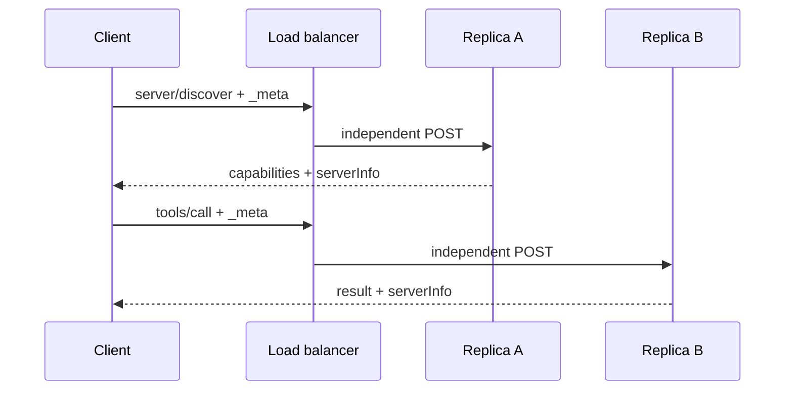
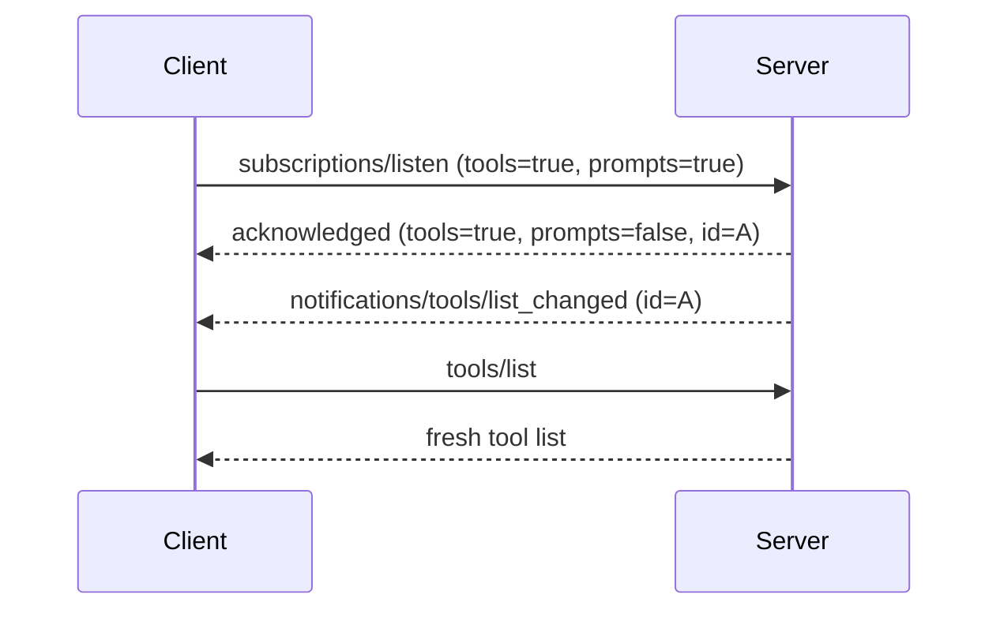
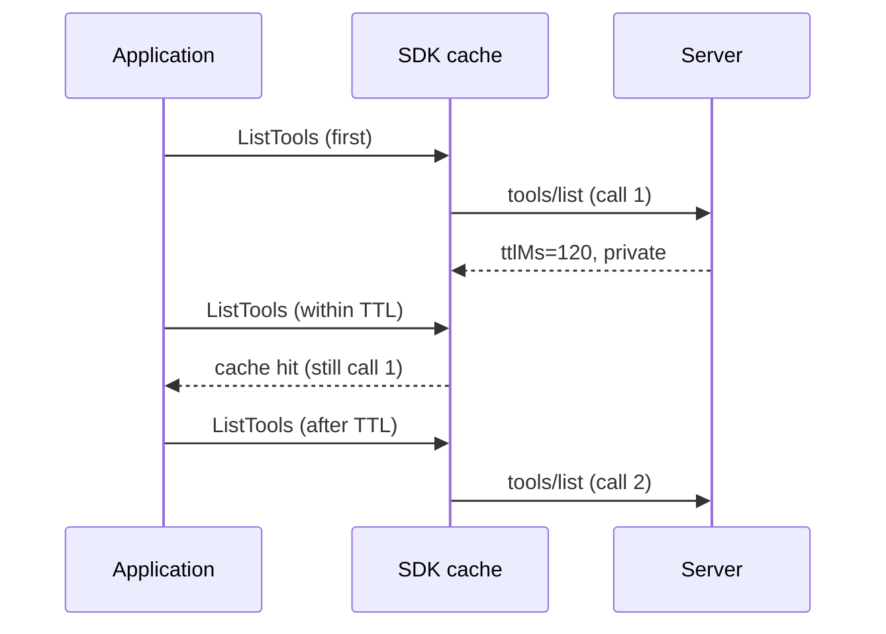
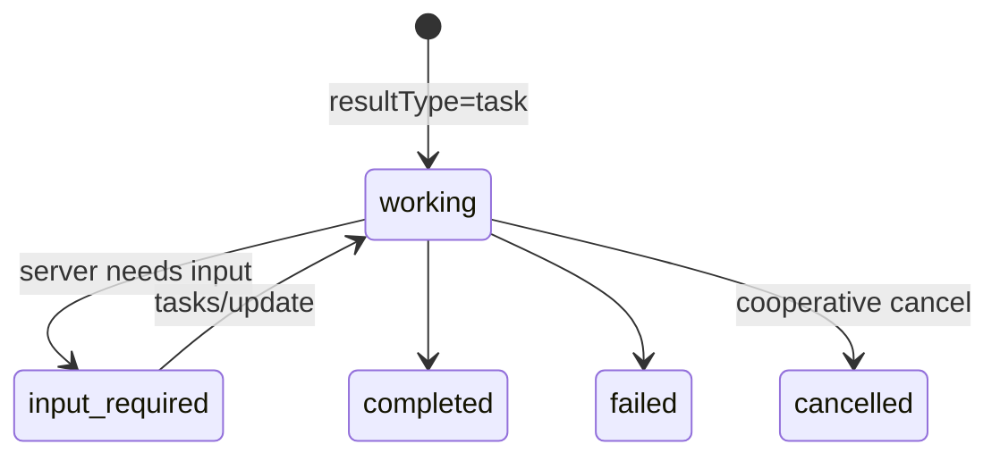

MCP `2026-07-28` is not a minor release that merely renames fields. It moves the protocol core from “establish a bidirectional session, then exchange messages inside it” toward a model that better fits Web infrastructure: **each request is self-describing, independently routable, and explicitly cacheable; interactions and long-running work have clear protocol contracts**. This directly addresses common production problems: sticky routing, rolling deployments, gateways that cannot inspect bodies, retrying after disconnects, and OAuth trust boundaries.

This article draws on the official [release announcement][release], [changelog][changelog], [specification][spec], [Go SDK v1.7.0][gosdk-release], and nine executable examples in [go-training/mcp-2026-07-28][sample]. Their roles differ: the specification defines wire semantics, the SDK defines the public Go API, and the examples and tests only demonstrate the behavior they cover. Tasks in particular are standardized in the specification, while v1.7.0 does not yet provide a complete typed API.

By the end, you should be able to answer four questions: how MCP becomes easier to scale horizontally, how to complete an interaction without a session, what a gateway can safely observe, and which layer server, client, and platform owners should migrate first.

For hands-on verification, refer to the training examples for [01 Stateless][ex01], [02 Subscriptions][ex02], [03 MRTR][ex03], [04 Cache][ex04], [05 HTTP headers][ex05], [06 Deprecations][ex06], [07 MCPGODEBUG][ex07], [08 Authorization][ex08], and [09 Extensions / Tasks][ex09].

| Area | Common `2025-11-25` model | `2026-07-28` focus | Primary beneficiary |
| --- | --- | --- | --- |
| Connection | Initialization and a session bind subsequent traffic | Per-request metadata and optional discovery | Server / platform |
| Interaction | Server-initiated reverse RPC | MRTR retries and the Tasks extension | Client / agent |
| Listings | Refetch or guess at caching | `ttlMs`, `cacheScope`, and invalidation | Client / LLM host |
| HTTP | Routing requires parsing JSON bodies | `Mcp-*` headers verified against the body | Gateway / SRE |
| Extensibility | The core keeps growing | Explicit extensions with bilateral opt-in | SDK / platform |

<!--more-->

## 1. Change the mental model: from implicit sessions to self-describing requests

The old flow sends `initialize` followed by `notifications/initialized`; the server keeps the protocol version, client capabilities, and identity in the session. Every later request must reach the same instance. That creates sticky-load-balancing requirements and makes failover, autoscaling, and mixed versions during deployment harder.

The new version requires requests to carry the protocol version, client capabilities, and client information in `params._meta`; servers should put `serverInfo` in the `_meta` of every result. `server/discover` is a server capability-probing method that servers **must** implement; clients **may** call it first, but it is not a mandatory new handshake. In v1.7.0, `Client.Connect` attempts discovery first and falls back to legacy `initialize` if it fails.

```go
handler := mcp.NewStreamableHTTPHandler(
    func(*http.Request) *mcp.Server { return server },
    &mcp.StreamableHTTPOptions{
        Stateless: true,
        JSONResponse: true,
    },
)

// The handler can read metadata for this request with
// req.ProtocolVersion(), req.ClientInfo(), and req.ClientCapabilities().
```

The key is `Stateless: true`. It allows Streamable HTTP to accept `2026-07-28`, neither reads nor writes `Mcp-Session-Id`, and returns `405` for standalone GET and DELETE. If a server remains stateful, the Go SDK negotiates `2025-11-25`; code compiling successfully is not a substitute for checking the negotiated version.



This removes transport-session baggage from ordinary round-robin routing, rolling deployments, and failover. But **sessionless does not mean the application is stateless**. Cross-request workflows, rate limits, auth context, and long work may still require shared durable storage. Return a server-minted, high-entropy `stateHandle` and require it explicitly on the next request; validate tenant, expiry, authorization, and replay protection every time. Never use a bare database ID or user ID as the handle.

> `server/discover` is not a mandatory handshake before every business request. Likewise, a broken stream cannot reuse an old JSON-RPC ID or expect replay through `Last-Event-ID`; side-effecting operations need an idempotency key or queryable explicit state.

## 2. Stateless does not mean no long-lived connection: `subscriptions/listen`

The new version does not ban server events. Instead, it makes requested events an explicit opt-in, long-lived POST-response stream. `subscriptions/listen` has four independent core-notification switches: tools, prompts, resource-list changes, and subscriptions to specific resource URIs. Its first message must be `notifications/subscriptions/acknowledged`; the accepted set may be a subset of the client request and includes a subscription ID.



In Go SDK v1.7.0, configured list-change handlers in `ClientOptions` automatically start the listen stream and invalidate the relevant cache **before** calling your handler. Usually the handler only needs to refresh the UI or trigger the next list request; do not maintain hidden state that competes with the SDK cache. The existing `ClientSession.Subscribe` API maps to a resource-subscription listen stream for modern peers and uses the old wire RPC only for legacy peers.

`subscriptions/listen` is not an exactly-once event log and provides no historical replay. Reconnect and listen again after an unexpected disconnect or normal completion when events are still needed. Proxy buffering, idle timeouts, and connection limits must accommodate long responses. `notifications/progress` and `notifications/message` still belong on the response stream for their original request and should not be placed in a subscription.

## 3. Complete multi-step interactions without a session with MRTR

When a tool needed more information in the past, servers could issue reverse requests such as `elicitation/create`, sampling, or roots requests. That depended on a continuing bidirectional channel. Multi Round-Trip Requests (MRTR) bring the interaction back to a client-initiated model: the server returns `resultType: "input_required"`; after collecting input, the client resends the original operation with a **new JSON-RPC ID**.

```json
// Result of the first tools/call
{
  "resultType": "input_required",
  "inputRequests": {"approval": {"method": "elicitation/create"}},
  "requestState": "opaque-deploy-state-v1"
}

// After collecting approval, resend the same operation with a new ID
{"id":3,"method":"tools/call","params":{"name":"deploy",
 "inputResponses":{"approval":{"action":"accept","content":{"ticket":"OPS-2575"}}},
 "requestState":"opaque-deploy-state-v1"}}
```

Every modern result has a `resultType`: `input_required` is an interim result, while `complete` is the final or ordinary result. When a legacy server omits the field, clients must treat it as `complete`. URL elicitation also removes the old `elicitationId` and completion notification.

The example demonstrates a frequently misunderstood point: application code calls `CallTool` once, and SDK middleware performs the protocol retry, but the tool handler runs twice, not three times. The first round must not perform irreversible side effects. `requestState` is opaque correlation state, not authorization proof; signatures or encryption, expiry, replay protection, and idempotency remain application responsibilities.

## 4. Lists can finally be cached safely: `ttlMs`, `cacheScope`, and stable ordering

Results from `tools/list`, `prompts/list`, `resources/list`, template listings, and `resources/read` can carry `ttlMs` and `cacheScope`. `ttlMs=0` means immediately stale; a positive value is a freshness hint counted from receipt of the response. `public` permits shared intermediary caching, while `private` is only for the current user's client cache.



The example proves a cache hit with a server-side counter of `1 → 1 → 2`; this is stronger evidence than comparing two result bodies. List-change notifications can invalidate before the TTL expires, so TTL and subscriptions complement each other.

The specification requires a **stable order** when the underlying tool set has not changed, reducing the likelihood that reordering an identical list breaks LLM prompt caching. That does not mean the specification requires alphabetical order: the SDK registry happens to order by feature ID, while custom list handlers and pagination may choose another consistent stable key. Each cursor page is a distinct cache entry, and pagination does not guarantee a cross-page snapshot. Reauthorize when executing a tool or reading a resource.

> `ttlMs` is not a promise that data never changes, and it is not an authorization cache. User-specific results must explicitly use `private`; a client may also discard an entry before its TTL because of reconnects or memory pressure.

## 5. Let gateways understand MCP: HTTP header standardization

Streamable HTTP now mirrors routing data from the body into standard headers, so gateways, WAFs, rate limiters, and tracing systems do not have to parse JSON to understand a request.

| Header | Corresponding information | Purpose |
| --- | --- | --- |
| `Mcp-Protocol-Version` | `_meta` protocol version | Version routing and validation |
| `Mcp-Method` | JSON-RPC method | Operation routing |
| `Mcp-Name` | `name` or `uri` | Tool, prompt, or resource target |
| `Mcp-Param-*` | Schema-designated argument | Optional routing hint |

Only primitive string, integer, and boolean tool arguments marked `x-mcp-header` in the schema are exposed as `Mcp-Param-*`. For example, marking `region` with `x-mcp-header: "Region"` produces `Mcp-Param-Region`; an unmarked `query` is not copied implicitly. The client must inspect the tool schema rather than assuming every argument belongs in a header.

Before dispatching, the server must compare each header with the body. A missing required field or mismatch returns HTTP 400 and `HeaderMismatch (-32020)`. `-32000` through `-32019` are implementation-defined; `-32020` through `-32099` are reserved for the MCP specification. Current reserved errors also include `-32021 MissingRequiredClientCapability` and `-32022 UnsupportedProtocolVersion`.

```text
Mcp-Method: tools/call      # must match the body method
Mcp-Name: search            # must match params.name in the body
Mcp-Param-Region: ap-east-1 # only a field explicitly selected by schema
```

Non-ASCII values use the `=?base64?...?=` sentinel encoding. This safely places a value in an HTTP field value; it is **not encryption**. Proxy logs and tracing backends can recover the original value. Do not expose tokens, passwords, PII, large prompts, or a sole authorization decision. Headers are observable routing hints; the server must still authorize tenant, region, and resource access based on the authenticated principal.

## 6. Authorization hardening: establish where the code came from

The core of an OAuth mix-up attack is not forged code. A malicious or mistaken issuer sends a client to an honest authorization server for a valid code, and the client then sends that code to the wrong token endpoint. `state` prevents CSRF and PKCE binds the code verifier; neither replaces RFC 9207 issuer identification.

The 2026-07-28 specification requires clients to validate the authorization response's `iss` against the discovered issuer **before** redeeming the code. If an authorization server advertises support but omits `iss`, or if it does not match, abort rather than “trying the token endpoint first.” The example uses a token-endpoint counter to prove that only the matching case changes from 0 to 1; missing and mismatched cases remain at 0.

Credential-store keys must also include the issuer: when resource metadata points to another authorization server, an old client ID, secret, or refresh token cannot be reused. New client registrations should prefer preregistration or [CIMD][cimd]; DCR remains a compatibility fallback, not a removed feature. DCR must derive `application_type: native` for loopback or custom-scheme redirects and `web` for remote HTTPS redirects.

> DCR is deprecated in this release, not removed. `2027-07-28` is the earliest possible removal date, not a guaranteed date. For further reading on CIMD, RFC 9207, and implementation details, see this blog's [CIMD hands-on post][cimd-post], [issuer identification post][issuer-post], and [mix-up demo][mixup-post].

## 7. Put non-core capabilities back behind an evolvable boundary: Extensions and Tasks

The Extensions framework uses reverse-domain identifiers so capabilities can evolve independently. Servers declare support in `server/discover`; clients explicitly opt in through capability metadata on **every request**. A declaration on only one side is not negotiation: implementations must provide a core fallback or an explicit missing-capability error. `io.modelcontextprotocol/*` is reserved for MCP; vendors should use their own prefix.

Go SDK v1.7.0 supports generic extensions through `ClientCapabilities.AddExtension`, `ServerCapabilities.AddExtension`, and custom methods. The SDK does not calculate capability intersections or automatically feature-gate handlers. The example uses `com.example/extension-probe` specifically to avoid claiming an official capability that it does not actually fulfill.

Tasks is now the official `io.modelcontextprotocol/tasks` extension rather than experimental core. It supports long work that can outlive a timeout, disconnect, or process restart: an opted-in server may return `resultType: "task"` from `tools/call`; clients poll with `tasks/get`, send input with `tasks/update` when needed, and request cooperative cancellation through `tasks/cancel`. Both sides may subscribe to `notifications/tasks` through a listen stream.



A Tasks `taskId` is not authorization proof. Validate the bearer token, tenant, and task ownership on every follow-up; multi-replica designs also need durable storage, while header routing affinity is only an optimization.

> **Go SDK boundary:** v1.7.0 has no typed `Task` or `CreateTaskResult`, standard `tasks/get|update|cancel` methods, task-aware `CallToolResult`, or typed task-notification API. Example 09 only proves generic extension negotiation; it does not implement the official Tasks protocol. Do not disguise homemade Go types as complete SDK support.

## 8. Capabilities that are being retired

Deprecated means there is a migration window; it does not mean an SDK type disappears immediately. New designs should not treat these as core dependencies:

| Deprecated feature | Replacement direction | Earliest removal / note |
| --- | --- | --- |
| Roots | Explicit arguments, resource URIs, deployment config | Only a revision after `2027-07-28` may remove it |
| Sampling | Client-owned orchestration or direct server-provider integration | Same |
| Logging | stderr, `slog`, OpenTelemetry | Same |
| DCR | Preregistration / CIMD | Same; remains a fallback |
| Legacy HTTP+SSE | Stateless Streamable HTTP | Legacy session transport is deprecated, not all SSE framing |
| `includeContext` | Omit it or use `"none"` | Retires with Sampling |

MRTR solves human-input round trips, but it does not reverse the decision to deprecate Roots or Sampling. Logging should likewise stop being an implicit cross-request setting: a STDIO server writes application logs to stderr, while an HTTP service uses its established structured logging and OTel. SEP-414 additionally places `traceparent`, `tracestate`, and `baggage` in `_meta`; across trust boundaries, validate their format, limit their size, and allowlist baggage. Never use them as authorization inputs.

## 9. A temporary safety net for Go SDK upgrades: `MCPGODEBUG`

Version 1.7.0 adds seven `MCPGODEBUG` compatibility flags for temporarily restoring old wire expectations during a rollout. They are read during package initialization, making them a Go SDK migration mechanism rather than an MCP capability. Compare default behavior with `=1` in a new process; calling `os.Setenv` in `main()` is already too late.

| Flag | Default → compatibility mode with `=1` |
| --- | --- |
| `customresnotfounderrcode` | Resource-not-found `-32602` → `-32002` |
| `hintomitempty` | Serialize false tool hints → omit false hints |
| `allowsessionsinstateless` | DELETE 405 → accept session DELETE (204) |
| `nomethodnotfoundcodeinerror` | Unknown method `-32601` → legacy zero code |
| `noprotocolerrorbody` | Decode non-2xx JSON-RPC error → only HTTP status |
| `nowrapinvalidparams` | Decode failure `-32602` → legacy zero code |
| `disablecompleteparamsvalidation` | Validate `completion/complete` params → dispatch malformed params |

All seven are planned for removal in v1.9.0. They are appropriate as canary or rollback escape hatches with an owner, metrics, and an expiry date, not as permanent environment variables. Keep every replica configured identically, and have CI run a job with `MCPGODEBUG` cleared to prevent the compatibility layer from becoming the actual default.

## 10. Two more easily missed changes

- SEP-2106 relaxes schemas: full JSON Schema 2020-12 keywords are allowed, and `structuredContent` may be any JSON value. Still place depth and node limits on `$ref` resolution, and do not put complex values into headers for routing.
- Resource-not-found aligns with JSON-RPC `Invalid Params (-32602)`; corrected number handling in schema generators and the SEP governance process improve correctness and governance, but should not be marketed as new runtime features.

## 11. Role-based migration checklist

| Owner | Do now | Do later |
| --- | --- | --- |
| MCP server | Enable `Stateless`, read per-request metadata, use explicit state, send cache hints, verify header/body, replace deprecated features | Add typed Tasks APIs when SDK support arrives |
| MCP client | Discovery/legacy fallback, retry with a new ID, reconnect listen streams, invalidate caches, RFC 9207 `iss`, issuer-keyed credentials | Optional extensions and removal of migration flags |
| Platform / gateway | Header allowlist and consistency checks, stream timeouts, credential isolation, rolling-version observability | Durable task storage and full OTel instrumentation |

You can validate the training material with Go 1.25+ and the pinned Go SDK v1.7.0:

```bash
git clone https://github.com/go-training/mcp-2026-07-28.git
cd mcp-2026-07-28
go test ./...

# To observe individual chapters, run the corresponding directory from 01 to 09.
go run ./01-stateless-sessionless
go run ./05-http-standardization
go run ./08-authorization-hardening
```

## Conclusion

The value of this release is not simply one fewer session header or one more HTTP header. It turns version, capability, routing, interaction state, cache freshness, and extension negotiation from implicit connection memory into contracts that can be observed, verified, and handled across multiple replicas.

For an MCP deployment already in production, first confirm the negotiated version and `Stateless` setting. Then inventory dependencies on sessions, reverse RPC, and legacy transport; add issuer validation and reconnect behavior to clients; and finally build header validation, proxy timeouts, and credential isolation into the platform rollout. That is how “stateless” becomes a reliable, governable Web workload.

[release]: https://blog.modelcontextprotocol.io/posts/2026-07-28/
[changelog]: https://modelcontextprotocol.io/specification/2026-07-28/changelog
[spec]: https://modelcontextprotocol.io/specification/2026-07-28
[sample]: https://github.com/go-training/mcp-2026-07-28
[ex01]: https://github.com/go-training/mcp-2026-07-28/tree/main/01-stateless-sessionless
[ex02]: https://github.com/go-training/mcp-2026-07-28/tree/main/02-subscriptions-listen
[ex03]: https://github.com/go-training/mcp-2026-07-28/tree/main/03-multi-round-trip
[ex04]: https://github.com/go-training/mcp-2026-07-28/tree/main/04-cacheable-list-results
[ex05]: https://github.com/go-training/mcp-2026-07-28/tree/main/05-http-standardization
[ex06]: https://github.com/go-training/mcp-2026-07-28/tree/main/06-deprecated-features
[ex07]: https://github.com/go-training/mcp-2026-07-28/tree/main/07-mcpgodebug
[ex08]: https://github.com/go-training/mcp-2026-07-28/tree/main/08-authorization-hardening
[ex09]: https://github.com/go-training/mcp-2026-07-28/tree/main/09-extensions-and-tasks
[gosdk-release]: https://github.com/modelcontextprotocol/go-sdk/releases/tag/v1.7.0
[cimd]: https://modelcontextprotocol.io/specification/2026-07-28/basic/authorization/client-registration
[cimd-post]: https://blog.wu-boy.com/2026/08/mcp-cimd-hands-on-signet/
[issuer-post]: https://blog.wu-boy.com/2026/07/rfc9207-issuer-identification-mcp-mixup/
[mixup-post]: https://blog.wu-boy.com/2026/07/rfc9207-mcp-mixup-attack-demo/
