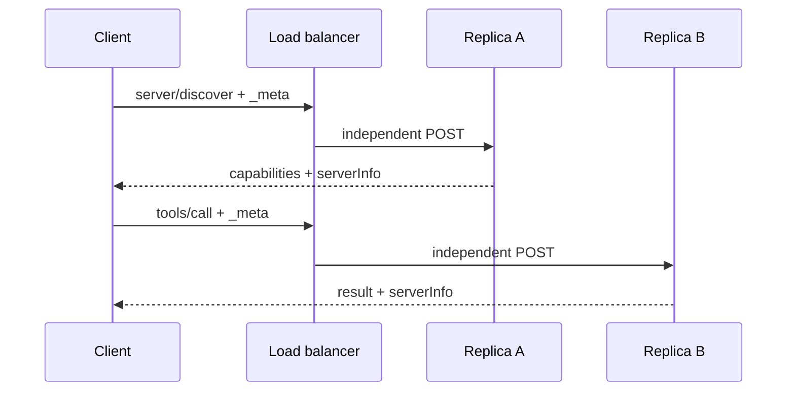
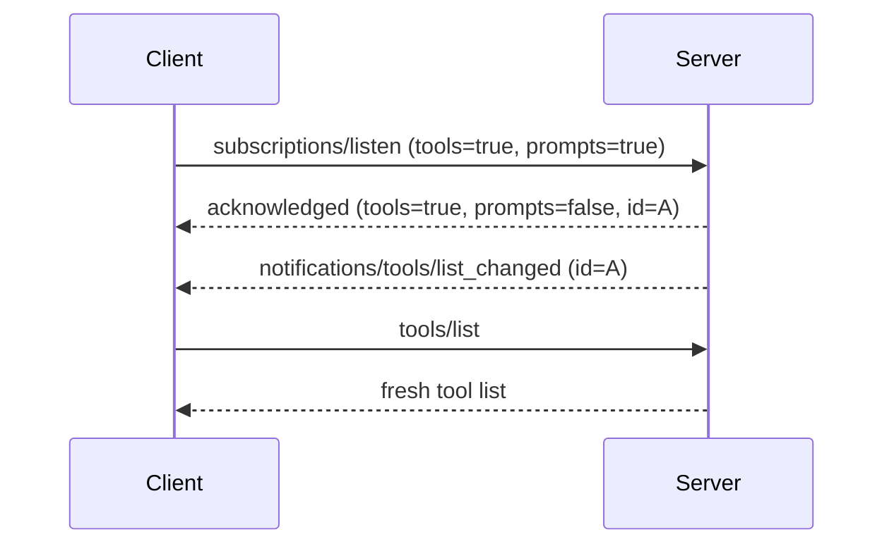
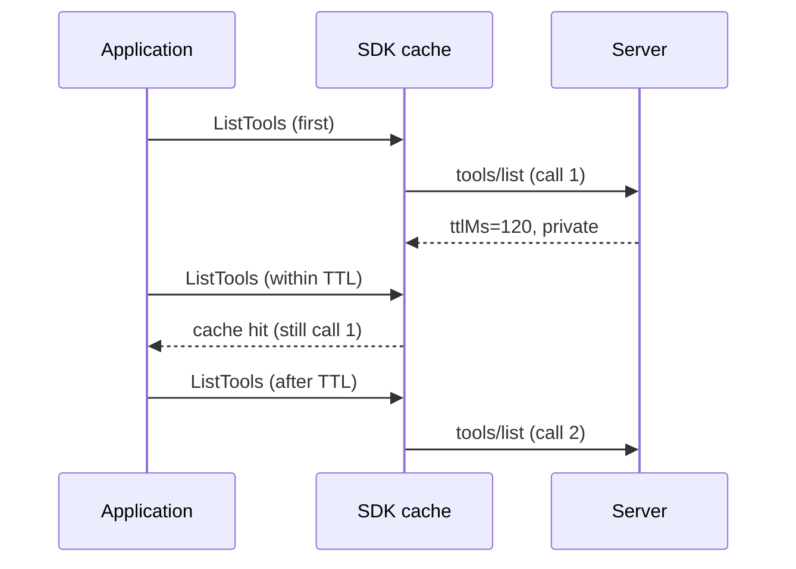
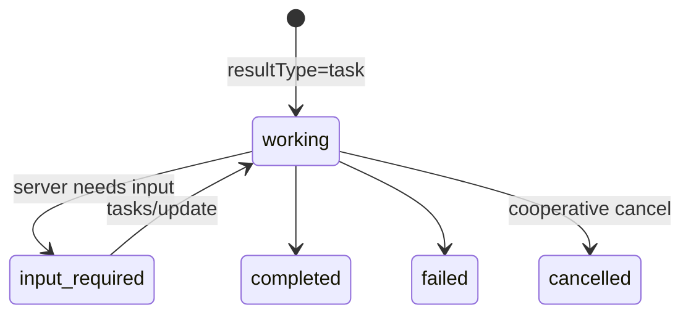

MCP `2026-07-28` 不是一次把欄位改名的小改版。它把協定核心從「先建立雙向 session，再在裡面交換訊息」改為更接近 Web 基礎設施擅長處理的模式：**每個 request 自我描述、可獨立路由、可明確快取，互動與長工作則有明確的 protocol contract**。這正好處理 production 最常見的麻煩：sticky routing、滾動部署、gateway 看不懂 body、斷線重試與 OAuth 信任邊界。

本文以官方 [release announcement][release]、[changelog][changelog] 與 [specification][spec]、[Go SDK v1.7.0][gosdk-release]，以及可執行的 [go-training/mcp-2026-07-28][sample] 九組範例為依據。三者的角色不同：規格定義 wire semantics，SDK 定義公開 Go API，範例與測試只證明它實際覆蓋的行為；尤其 Tasks，規格已正式化，但 v1.7.0 尚未有完整 typed API。

讀完你應該能回答四件事：怎麼讓 MCP 更容易水平擴展、怎麼在無 session 下完成互動、gateway 能安全觀察什麼，以及 server、client、platform 各自該先遷移哪一層。

想邊讀邊驗證，可直接對照教材的 [01 Stateless][ex01]、[02 Subscriptions][ex02]、[03 MRTR][ex03]、[04 Cache][ex04]、[05 HTTP headers][ex05]、[06 Deprecations][ex06]、[07 MCPGODEBUG][ex07]、[08 Authorization][ex08] 與 [09 Extensions / Tasks][ex09]。

| 面向 | `2025-11-25` 常見模型 | `2026-07-28` 的重點 | 主要受益者 |
| --- | --- | --- | --- |
| 連線 | initialization 與 session 綁住後續流量 | per-request metadata、optional discovery | server／platform |
| 互動 | server-initiated reverse RPC | MRTR retry、Tasks extension | client／agent |
| 清單 | 重抓或各自猜 cache | `ttlMs`、`cacheScope`、invalidation | client／LLM host |
| HTTP | routing 要解析 JSON body | `Mcp-*` headers 並比對 body | gateway／SRE |
| 擴充 | core 不斷長大 | 雙方 opt-in extensions | SDK／platform |

<!--more-->

## 一、先換心智模型：從隱含 session 到 self-describing request

舊流程先送 `initialize` 與 `notifications/initialized`，server 在 session 留下 protocol version、client capabilities 與 identity。後續 request 必須回到同一 instance；這不只需要 sticky load balancing，也讓 failover、autoscaling 與部署中的版本共存變複雜。

新版要求 request 在 `params._meta` 帶上 protocol version、client capabilities 與 client info；server 也應在每個 result 的 `_meta` 放 `serverInfo`。`server/discover` 是 server **必須**實作的能力探測，client **可以**先呼叫，卻不是新的 mandatory handshake。v1.7.0 的 `Client.Connect` 會先嘗試 discovery，失敗時再 fallback 到 legacy `initialize`。

```go
handler := mcp.NewStreamableHTTPHandler(
    func(*http.Request) *mcp.Server { return server },
    &mcp.StreamableHTTPOptions{
        Stateless: true,
        JSONResponse: true,
    },
)

// handler 中可由 req.ProtocolVersion()、req.ClientInfo()
// 與 req.ClientCapabilities() 讀取這一次 request 的 metadata。
```

關鍵是 `Stateless: true`。它才會讓 Streamable HTTP 接受 `2026-07-28`、不讀寫 `Mcp-Session-Id`，也讓獨立 GET／DELETE 回 `405`。若 server 仍維持 stateful，Go SDK 會協商至 `2025-11-25`；「API 編譯成功」不能替代檢查實際 negotiated version。



這讓 plain round-robin、rolling deploy 與 failover 都少了 transport session 的包袱；但 **sessionless 不等於 application 無狀態**。跨 request workflow、rate limit、auth context 與長工作仍可能需要 shared durable store。正確做法是回傳 server mint 的高 entropy `stateHandle`，下次明確帶回；server 每次都驗證 tenant、期限、授權與 replay，不能把裸資料庫 ID 或 user ID 當成 handle。

> `server/discover` 不是每個業務 request 的前置 handshake。反過來說，stream 中斷也不能沿用舊 JSON-RPC ID 或期待 `Last-Event-ID` 重播；有副作用的操作要有 idempotency key 或可查詢的 explicit state。

## 二、Stateless 不等於沒有長連線：`subscriptions/listen`

新版不是禁止 server 向 client 發事件，而是把「要收哪些事件」變成明確 opt-in 的長生命週期 POST-response stream。`subscriptions/listen` 的 core notifications 有四個獨立開關：tools、prompts、resources list changed，以及特定 URI 的 resource subscriptions。第一個 message 必須是 `notifications/subscriptions/acknowledged`，其中的 accepted set 可以只是 client requested set 的 subset，並附 subscription ID。



Go SDK v1.7.0 會依 `ClientOptions` 裡已設定的 list-change handler 自動開 listen stream，而且在呼叫你的 handler **之前**先 invalidate 對應 cache。也就是說 handler 通常只需更新 UI 或觸發下一次 list；別再維護一份會與 SDK cache 競爭的隱藏狀態。既有 `ClientSession.Subscribe` API 對 modern peer 會轉成 resource subscription 的 listen stream，對 legacy peer 才走舊 wire RPC。

`subscriptions/listen` 不等於 exactly-once event log，也不提供歷史 replay。意外斷線、正常結束後仍要事件時都必須重新 listen；proxy buffering、idle timeout 與 connection limit 要能容納長回應。`notifications/progress`、`notifications/message` 仍是原 request 的 response stream，不該塞進 subscription。

## 三、用 MRTR 在無狀態協定完成多步互動

過去若 tool 需要補資料，server 很容易反向發 `elicitation/create`、sampling 或 roots request，這使它依賴持續的雙向 channel。Multi Round-Trip Requests（MRTR）把互動拉回 client-initiated model：server 回 `resultType: "input_required"`，client 收集 input 後以**新的 JSON-RPC ID**重送原 operation。

```json
// 第一次 tools/call 的結果
{
  "resultType": "input_required",
  "inputRequests": {"approval": {"method": "elicitation/create"}},
  "requestState": "opaque-deploy-state-v1"
}

// client 取得核准後，以新 ID 重送同一 operation
{"id":3,"method":"tools/call","params":{"name":"deploy",
 "inputResponses":{"approval":{"action":"accept","content":{"ticket":"OPS-2575"}}},
 "requestState":"opaque-deploy-state-v1"}}
```

所有新版 result 都有 `resultType`：`input_required` 是 interim result，`complete` 是最後／一般 result；legacy server 少了此欄位時，client 必須當作 `complete`。URL elicitation 同時移除了舊 `elicitationId` 與 completion notification。

範例刻意呈現一個常被誤解的點：application 只呼叫一次 `CallTool`，SDK middleware 完成 protocol retry，但 tool handler 會執行兩次，不是三次。因此第一 round 不應做不可逆副作用，`requestState` 只是 opaque correlation state，絕不是 authorization proof。簽章／加密、expiry、replay 防護與 idempotency 仍屬 application 責任。

## 四、清單終於能安全快取：`ttlMs`、`cacheScope` 與穩定排序

`tools/list`、`prompts/list`、`resources/list`、templates list、`resources/read` 等結果帶有 `ttlMs` 與 `cacheScope`。`ttlMs=0` 代表立即 stale；大於零是從收到 response 起的 freshness hint。`public` 可以被共享 intermediary 快取，`private` 僅能給當前使用者的 client 快取。



範例以 server-side counter 證明 `1 → 1 → 2`；這比只比對兩份結果文字更能證明 cache hit。list-changed notification 又可在 TTL 未到時主動 invalidation，因此 TTL 與 subscription 是互補關係。

規格要求 underlying tool set 不變時回傳**穩定排序**，降低相同清單因排列變動而破壞 LLM prompt cache 的機率。請別把它誤寫成「規格要求 alphabetical」：SDK registry 剛好按 feature ID 排，自己寫 list handler 或 pagination 時可使用另一個一致的 stable key。每個 cursor page 是不同 cache entry，pagination 也不保證跨頁 snapshot；真正執行 tool／read resource 時仍必須重新驗權。

> `ttlMs` 不是資料永遠不變的承諾，更不是 authorization cache。user-specific result 要明確設 `private`，client 也可以早於 TTL 因重連或記憶體壓力丟棄它。

## 五、讓 Gateway 看懂 MCP：HTTP header standardization

Streamable HTTP 現在把 body 裡的 routing 資訊鏡射到標準 headers，讓 gateway、WAF、rate limiter 和 tracing 不必解析 JSON 才知道 request 做什麼。

| Header | 對應資訊 | 用途 |
| --- | --- | --- |
| `Mcp-Protocol-Version` | `_meta` protocol version | version routing／validation |
| `Mcp-Method` | JSON-RPC method | operation routing |
| `Mcp-Name` | `name` 或 `uri` | tool／prompt／resource target |
| `Mcp-Param-*` | schema 標示的 argument | 選擇性 routing hint |

Tool schema 中只有標記 `x-mcp-header` 的 string、integer、boolean primitive argument 才會曝露成 `Mcp-Param-*`。例如 `region` 標 `x-mcp-header: "Region"` 會產生 `Mcp-Param-Region`；未標註的 `query` 不會被偷偷複製。client 必須先看過 tool schema，不能自行猜所有 argument 都要進 header。

Server 在 dispatch 前必須逐一比對 header 與 body；缺少必要欄位或不一致時回 HTTP 400 與 `HeaderMismatch (-32020)`。`-32000` 到 `-32019` 是 implementation-defined，`-32020` 到 `-32099` 則保留給 MCP specification；目前還有 `-32021 MissingRequiredClientCapability` 與 `-32022 UnsupportedProtocolVersion`。

```text
Mcp-Method: tools/call      # body 的 method 必須相同
Mcp-Name: search            # body 的 params.name 必須相同
Mcp-Param-Region: ap-east-1 # 僅 schema 明確選出的欄位
```

非 ASCII value 會用 `=?base64?...?=` sentinel 編碼。這是為了安全放進 HTTP field value，**不是 encryption**；proxy log 與 tracing backend 都能解回原文。因此不要曝露 token、password、個資、大型 prompt 或唯一授權依據。header 只是可觀察的 routing hint，server 仍要依 authenticated principal 驗證 tenant、region、resource permission。

## 六、Authorization hardening：先確定 code 到底來自誰

OAuth mix-up 的核心不是 code 偽造，而是 client 被惡意／錯誤 issuer 帶去誠實 AS 拿到合法 code 後，又把 code 送到錯誤 token endpoint。`state` 防 CSRF，PKCE 綁定 code verifier；兩者都不能取代 RFC 9207 的 issuer identification。

2026-07-28 要求 client 在 code redemption **之前**驗證 authorization response 的 `iss` 是否等於 discovery 到的 issuer。若 AS 廣告支援卻缺少 `iss`，或 `iss` 不一致，就中止而不是「先試 token endpoint 看看」。範例以 token endpoint counter 證明：matching case 才從 0 變 1，missing／mismatched case 都停在 0。

同樣重要的是 credential store 的 key 必須包含 issuer：resource metadata 改指向另一 AS，就不能沿用舊 client ID、secret 或 refresh token。新部署的 client registration 優先考慮 preregistration 或 [CIMD][cimd]；DCR 仍是 compatibility fallback，尚未移除。DCR 對 loopback／custom scheme redirect 要推導 `application_type: native`，remote HTTPS redirect 則是 `web`。

> DCR 在本版是 deprecated，不是已 removed；`2027-07-28` 是最早可能移除的日期，不是保證移除日。CIMD、RFC 9207 與實作細節可延伸閱讀本站的 [CIMD 實戰][cimd-post]、[issuer identification][issuer-post] 與 [mix-up demo][mixup-post]。

## 七、把非核心能力放回可演進的邊界：Extensions 與 Tasks

Extensions framework 用 reverse-domain identifier 讓能力獨立演進。server 在 `server/discover` 宣告支援；client 在**每次 request** 的 capability metadata 也明確 opt in。只有一邊宣告不構成 negotiation，實作必須提供 core fallback 或明確 missing-capability error。`io.modelcontextprotocol/*` 是 MCP 保留 namespace，vendor 應使用自己的 prefix。

Go SDK v1.7.0 可用 `ClientCapabilities.AddExtension`、`ServerCapabilities.AddExtension` 以及 custom methods 建立 generic extension；SDK 不會替你計算 capability 交集或自動 feature-gate handler。範例採 `com.example/extension-probe`，正是為了不把尚未真正履行的 official capability 宣告出去。

Tasks 已是官方 `io.modelcontextprotocol/tasks` extension，不再是 experimental core。它適合跨 timeout、斷線或 process restart 的長工作：server 可令已 opt-in 的 `tools/call` 回 `resultType: "task"`，client 用 `tasks/get` polling，input-required 時 `tasks/update`，以 cooperative `tasks/cancel` 提出取消；雙方也可透過 listen stream 訂閱 `notifications/tasks`。



Tasks 的 `taskId` 不是 authorization proof。每次 follow-up 都驗 bearer token、tenant 與 task ownership；多 replica 設計也要先有 durable store，header routing affinity 只能是最佳化。

> **Go SDK 邊界：** v1.7.0 沒有 typed `Task`／`CreateTaskResult`、標準 `tasks/get|update|cancel` methods、task-aware `CallToolResult` 或 typed task notification API。九號範例只證明 generic extension negotiation，沒有實作 official Tasks protocol；別用自造 Go types 假裝它已完整支援。

## 八、哪些能力正在退場

deprecated 表示有遷移窗口，不等於 SDK type 立刻消失。新設計不應再把它們當核心依賴：

| Deprecated feature | 替代方向 | 最早移除／注意事項 |
| --- | --- | --- |
| Roots | explicit arguments、resource URI、deployment config | `2027-07-28` 後的 revision 才有資格移除 |
| Sampling | client-owned orchestration 或 server direct provider integration | 同上 |
| Logging | stderr、`slog`、OpenTelemetry | 同上 |
| DCR | preregistration／CIMD | 同上；仍是 fallback |
| legacy HTTP+SSE | stateless Streamable HTTP | 被淘汰的是 legacy session transport，不是所有 SSE framing |
| `includeContext` | omit 或 `"none"` | 隨 Sampling 退場 |

MRTR 能解決補人類輸入的 round trip，但不會取消 Roots、Sampling 的 deprecation 決策。logging 也不該再是跨 request 的隱含設定：STDIO server 的 application log 寫 stderr；HTTP service 使用既有 structured logging 與 OTel。SEP-414 另約定把 `traceparent`、`tracestate`、`baggage` 放在 `_meta`；它們跨 trust boundary 時須驗格式、限大小、allowlist baggage，不能拿來當授權輸入。

## 九、Go SDK 升級的暫時安全網：`MCPGODEBUG`

v1.7.0 新增七個 `MCPGODEBUG` compatibility flags，讓 rollout 遇到舊 wire expectation 時可短暫退回。它們在 package init 讀取，是 Go SDK migration mechanism，不是 MCP capability；請用新 process 比較 default 與 `=1`，在 `main()` 裡 `os.Setenv` 已經太晚。

| Flag | 預設 → `=1` compatibility |
| --- | --- |
| `customresnotfounderrcode` | resource-not-found `-32602` → `-32002` |
| `hintomitempty` | serialize false tool hints → omit false hints |
| `allowsessionsinstateless` | DELETE 405 → accept session DELETE (204) |
| `nomethodnotfoundcodeinerror` | unknown method `-32601` → legacy zero code |
| `noprotocolerrorbody` | decode non-2xx JSON-RPC error → only HTTP status |
| `nowrapinvalidparams` | decode failure `-32602` → legacy zero code |
| `disablecompleteparamsvalidation` | validate `completion/complete` params → dispatch malformed params |

七項都預計在 v1.9.0 移除。它們適合有 owner、metrics、期限的 canary／rollback escape hatch，不是永久環境變數。每個 replica 應保持相同設定，CI 也要有清空 `MCPGODEBUG` 的 job，阻止相容層變成真正 default。

## 十、還有兩個容易漏看的變更

- SEP-2106 放寬 schema：可使用完整 JSON Schema 2020-12 keywords，`structuredContent` 可為任意 JSON value；但 `$ref` 解析仍要設深度／節點資源上限，別為 routing 把 complex value 塞 header。
- resource-not-found 對齊 JSON-RPC `Invalid Params (-32602)`；schema generator 的 number 修正、SEP governance 流程則是正確性／治理改良，不該包裝成新的 runtime feature。

## 十一、角色導向 migration checklist

| Owner | 現在就做 | 可稍後做 |
| --- | --- | --- |
| MCP server | 開 `Stateless`、讀 per-request metadata、改 explicit state、送 cache hints、驗 header/body、替換 deprecated feature | 依 SDK 支援加入 Tasks typed API |
| MCP client | discovery/legacy fallback、新 ID retry、listen reconnect、cache invalidation、RFC 9207 `iss`、issuer-keyed credential | optional extensions、移除 migration flags |
| Platform / gateway | header allowlist 與一致性、stream timeout、credential isolation、rolling-version observability | task durable store、完整 OTel instrumentation |

驗證教材可用 Go 1.25+ 與固定 Go SDK v1.7.0：

```bash
git clone https://github.com/go-training/mcp-2026-07-28.git
cd mcp-2026-07-28
go test ./...

# 想逐章觀察，執行 01 到 09 各目錄的 go run。
go run ./01-stateless-sessionless
go run ./05-http-standardization
go run ./08-authorization-hardening
```

## 結論

這版真正的價值不是少了一個 session header，或多了一個 header。它把 version、capability、routing、互動狀態、cache freshness 與 extension negotiation，從連線內的隱含記憶，轉成可觀察、可驗證、可在多 replica 間處理的 contract。

若你的 MCP 已上 production，最實際的起點是先確認 negotiated version 與 `Stateless` 設定，接著盤點 session／reverse RPC／legacy transport 依賴；client 補上 issuer validation 與 reconnect，platform 再把 header validation、proxy timeout 與 credential isolation 做進 rollout。如此才能把「無狀態」真正落成可靠、可治理的 Web workload。

[release]: https://blog.modelcontextprotocol.io/posts/2026-07-28/
[changelog]: https://modelcontextprotocol.io/specification/2026-07-28/changelog
[spec]: https://modelcontextprotocol.io/specification/2026-07-28
[sample]: https://github.com/go-training/mcp-2026-07-28
[ex01]: https://github.com/go-training/mcp-2026-07-28/tree/main/01-stateless-sessionless
[ex02]: https://github.com/go-training/mcp-2026-07-28/tree/main/02-subscriptions-listen
[ex03]: https://github.com/go-training/mcp-2026-07-28/tree/main/03-multi-round-trip
[ex04]: https://github.com/go-training/mcp-2026-07-28/tree/main/04-cacheable-list-results
[ex05]: https://github.com/go-training/mcp-2026-07-28/tree/main/05-http-standardization
[ex06]: https://github.com/go-training/mcp-2026-07-28/tree/main/06-deprecated-features
[ex07]: https://github.com/go-training/mcp-2026-07-28/tree/main/07-mcpgodebug
[ex08]: https://github.com/go-training/mcp-2026-07-28/tree/main/08-authorization-hardening
[ex09]: https://github.com/go-training/mcp-2026-07-28/tree/main/09-extensions-and-tasks
[gosdk-release]: https://github.com/modelcontextprotocol/go-sdk/releases/tag/v1.7.0
[cimd]: https://modelcontextprotocol.io/specification/2026-07-28/basic/authorization/client-registration
[cimd-post]: https://blog.wu-boy.com/2026/08/mcp-cimd-hands-on-signet-zh-tw/
[issuer-post]: https://blog.wu-boy.com/2026/07/rfc9207-issuer-identification-mcp-mixup-zh-tw/
[mixup-post]: https://blog.wu-boy.com/2026/07/rfc9207-mcp-mixup-attack-demo-zh-tw/
