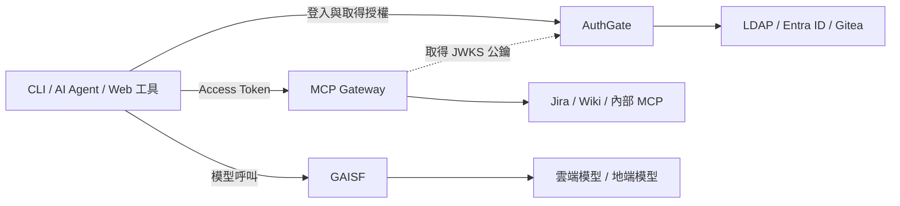

*整場分享以身分、授權期限與撤銷能力三個問題為主軸。（原投影片第 1 頁，可點圖放大。）*

這次在 [Hello World Dev Conference 2026](https://hwdc.ithome.com.tw/2026/)，我分享了「誰能用、用多久、出事能不能即時關掉？——AI 工具爆發時代的企業身分認證治理實戰」。這篇文章把演講中的架構與導入思路整理下來，也補充幾個實作時必須分清楚的技術邊界。

過去兩年，當公司內部的 AI Agent、MCP Server、CLI 工具與自動化腳本越來越多，我們遇到的問題也跟著改變。工具能不能完成任務，已經只是第一關；接下來要回答的是：**這個工具代表誰？可以存取哪些資源？授權什麼時候結束？如果憑證外洩，要在哪裡把它關掉？**

如果每個新工具都自己接 LDAP、自己存 API Key、自己處理 Token，工具數量增加的同時，也是在增加一批沒有人能完整盤點的存取入口。這場分享，就是從這個現場出發。

<!--more-->

## 演講資訊與資料

| 項目 | 內容 |
| --- | --- |
| 活動 | Hello World Dev Conference 2026 |
| 大會日期 | 2026 年 10 月 14–15 日 |
| 地點 | 臺北文創大樓 6 樓 |
| 講者 | 吳柏毅（Bo-Yi Wu / appleboy） |
| 演講長度 | 45 分鐘 |
| 主題 | AI 驅動的軟體開發資安新思維 |

本文依據[公開演講資料與完整投影片][slides-source]整理。各章截圖皆取自這份投影片，可點擊圖片查看大圖。投影片除了認證流程，也包含 Skill 管理、CLI 工具入口、MCP 上架與 AI 流量治理；把這些放在一起看，才能理解為什麼最後需要一個統一的身分入口。

## AI 導入之後，企業要一起管理三件事

*Agent 回答誰在執行、MCP 決定連接哪些系統、Skill 定義工作能力與流程。（原投影片第 6 頁，可點圖放大。）*

我們的導入從 2025 年整合企業內部 AI Gateway 開始，接著擴展到軟體部門，再到 2026 年的硬體部門，最後走向 AI Marketplace 平台。當使用者從少數工程師擴大到不同部門，平台就不能只是一張「有哪些 AI 工具」的清單。

投影片把管理對象拆成三個面向：

| 對象 | 要回答的問題 | 管理重點 |
| --- | --- | --- |
| AI Agent | 誰在執行任務？ | 使用者或服務身分、工具安裝、登入與憑證 |
| MCP | 能連到哪些系統？ | 服務上架、資源範圍、存取授權 |
| Skill | 具備哪些能力、遵循什麼流程？ | 分享、版本、存取權限與人為把關 |

例如，一個 Agent 讀取 Jira 工單、修改程式、開 PR，再更新看板，背後其實同時涉及這三層。Skill 定義工作流程，MCP 提供系統連接能力，而真正執行操作時，仍然必須知道它使用的是誰的身分、被允許做到哪裡。

**安裝了某個 Skill，不代表取得了對應系統的操作權限。** 工作流程與資源授權必須各自管理，再透過一致的身分串起來。

## 從 Skill 到 Jira：自動化越完整，身分越不能模糊

*把人為把關與 AI 執行的步驟分清楚，再把流程封裝成全團隊可重用的 Skill。（原投影片第 9 頁，可點圖放大。）*

我們把 Skill 放在內部 Gitea 分享，將存取權限與 Gitea 權限綁定，讓同仁能從 Code Review、Debugging、Testing、Documentation 等分類找到可重用的工作方法。

開發流程則從規劃一路串到合併：

1. 人先對齊需求，透過 `/plan-feature` 產出 `plan.md`。
2. AI 依計畫開發，再透過 `/simplify`、`/security-review`、`/code-review` 做品質檢查。
3. 透過 `/commit-message`、`/pr-prepare` 整理提交與 PR。
4. 由 `/loop` 搭配 `/copilot-review` 跑查閱意見、修正、再審查的迴圈。
5. 最後由人確認驗收條件與 CI 結果，再合併。

這套流程的重點，是讓團隊明確知道哪些步驟可以由 AI 執行，哪些決策需要人把關。搭配 CI 回報測試與狀態，Jira 看板才能反映工作進度。

但當 Agent 也要操作 Jira，就會碰到下一個問題：要開發專用 CLI，還是透過 MCP 串接？不論選哪一條路，**認證問題都不會因為接上工具而消失**。如果最後還是請使用者把一把長期 Token 貼進設定檔，就只是把手動操作換成自動操作，授權治理仍然留在原地。

## 三個被 AI 自動化放大的認證問題

*工具增加之後，認證維護、Token 生命週期與服務使用情況都需要集中管理。（原投影片第 24 頁，可點圖放大。）*

### 每個服務都自己接 LDAP

MCP、Bot、Web 工具、CLI 各寫一套認證，就會有多份 LDAP bind 帳密、多套錯誤處理與密碼規則。當目錄服務設定異動，每個服務都要跟著調整；想查一次完整的登入紀錄，又得翻不同系統的日誌。

新服務越容易做出來，這些重複實作就增加得越快。認證應該成為共用平台能力，讓服務開發者透過註冊與標準協定接入。

### 金鑰從設定檔流進 Git 與 shell history

MCP 最容易開始的接法，往往是在設定檔寫入 `Authorization: Bearer ...`。但 Token 可能跟著設定一起被 commit；改成 CLI 的 `--header` 參數，也可能留在 shell history。

當 Agent 能讀檔、執行指令，散落在開發環境的憑證也更容易被帶進工作流程。解法要涵蓋登入方式、憑證保存位置與有效期限，不能只靠提醒大家「小心不要 commit」。

### Token 發出去了，服務擁有者卻不知道誰在用

誰還持有有效 Token？當初授權了哪些 scope？多久沒用了？離職、換部門或發生事件時，要撤銷哪一筆？

如果這些問題只能靠人工翻資料庫或詢問工具作者，代表我們缺少的是整個生命週期的管理。使用者需要自助查詢與撤銷，服務擁有者需要看得見授權，管理員則需要集中處置的入口。

## AuthGate：把身分來源集中，把標準介面留給服務

*投影片呈現統一接入的方向；實作時仍須區分 OAuth Client 與 Resource Server 的角色。（原投影片第 25 頁，可點圖放大。）*

演講中的 AuthGate，是統一的身分認證閘道。對內集中整合 LDAP、Microsoft Entra ID、Gitea 等身分來源；對外提供 OAuth 2.0 / OIDC，讓服務透過標準流程取得身分與授權資訊。

這裡也要分清楚角色：CLI、Web 工具等可以是 OAuth Client；提供受保護 API 的 MCP Server 則扮演 Resource Server。AuthGate 負責授權與簽發 Token，MCP Gateway 負責在資源入口驗證請求。

這張圖裡有三個不同的治理位置：**AuthGate 管身分與授權，MCP Gateway 管工具對企業資源的存取，GAISF 管模型流量。** 它們分工合作，才構成完整的存取路徑。

機器身分也需要納入這套設計。互動式 CLI 可能代表某位使用者操作；無人值守的排程或服務，則應有自己的服務身分、責任歸屬與權限範圍，避免所有自動化都借用某位工程師的個人帳號。

## CLI 怎麼登入：Device Flow、PKCE 與服務身分

*圖中展示 Device Flow 的使用者授權過程；Authorization Code + PKCE 是另一種流程選擇，差異見下文。（原投影片第 26 頁，可點圖放大。）*

演講以「Device Flow + PKCE」介紹 CLI 與 MCP 的登入選項。落地時，應把不同情境分開理解：

| 情境 | 流程選擇 | 重點 |
| --- | --- | --- |
| CLI 所在環境不方便開啟瀏覽器或接收回呼 | Device Authorization Grant | 使用者到另一個瀏覽器完成登入與授權 |
| 工具能開啟瀏覽器並處理授權回呼 | Authorization Code + PKCE | 用 `code_verifier` 保護授權碼交換 |
| 沒有人在場的服務或排程 | Client Credentials 等服務身分方案 | 使用服務自己的身分，並安全保管及輪替憑證 |

Device Flow 的典型流程是：CLI 取得 device code 與 user code，顯示驗證網址，使用者在瀏覽器完成公司 SSO 登入與授權；CLI 按照伺服器要求的間隔輪詢，授權完成後取得 Token。**CLI 不需要內建瀏覽器，但流程仍需要使用者參與**，不能直接當成無人值守工作的登入方案。這個流程定義於 [RFC 8628][rfc8628]。

PKCE 則是 Authorization Code 流程中的保護機制，不能把兩個名詞理解成所有工具都必須依序跑完的單一流程。Client 與授權伺服器支援什麼，仍然要在接入時確認。

在投影片示範的設計中，取得的 Token 放進 OS keyring，避免直接寫入專案設定檔。這降低了憑證隨程式碼流出的機會；Refresh Token 也仍然是敏感憑證，需要到期、輪替與撤銷政策。

## MCP Gateway：把共同的授權驗證收進單一入口

*Gateway 驗證簽章與 claims，再傳遞身分和 scope；後端仍須執行資源層授權。（原投影片第 15 頁，可點圖放大。）*

要求每位 MCP 開發者自行處理 OAuth discovery、PKCE、JWT 驗證、JWKS 快取與金鑰輪替，維護成本很高，也容易產生不同的安全行為。

因此，演講中的架構以 Kong 搭配 `mcp-oauth2` plugin，集中處理 MCP 的認證入口。一次典型的授權與呼叫流程如下：

1. Client 未帶 Token 呼叫 MCP，Gateway 回傳 `401`，透過 `WWW-Authenticate` 指出 Protected Resource Metadata 的位置。
2. Client 讀取資源 metadata，找到授權伺服器，再取得它的授權端點資訊。
3. Client 對 AuthGate 執行 Authorization Code + PKCE，取得 Access Token。
4. Client 帶著 Token 重試；Gateway 透過 JWKS 公鑰驗證簽章，檢查 `iss`、`aud`、`exp`、Token 類型與所需 scope。
5. 通過後，Gateway 附上 `X-MCP-Subject` 與 `X-MCP-Scope`，轉發到後端 MCP Server。

**Client 自己向 AuthGate 取得授權，Gateway 不代替 Client 登入。** Gateway 集中的是資源探索與請求驗證，後端便能把心力放在工具功能與業務規則。

這個架構也有必要的信任邊界：後端必須限制為只能經由可信任的 Gateway 存取，Gateway 應清除或覆寫外部傳入的同名身分標頭。否則，Client 就可能繞過驗證，直接偽造身分。

另外，通過 Gateway 的 scope 檢查，不代表可以操作所有資料。使用者能不能修改某個 Jira 專案、讀取某一份文件，仍需要後端或下游系統的資源層授權。集中認證讓開發者少做重複工作，業務權限仍要守住。

相關實作可以接著看我之前整理的 [Kong + Signet MCP OAuth2 整合文章](/2026/06/kong-signet-mcp-oauth-zh-tw/)，以及 [kong-mcp-oauth2 專案](https://github.com/appleboy/kong-mcp-oauth2)。

## CCH 與 GAISF：讓使用者走得進來，也讓流量管得起來

*CCH 把登入與 Token 更新狀態放在同一個入口，畫面日期為演講示範資料。（原投影片第 19 頁，可點圖放大。）*

制度要落地，使用者需要一條容易操作的路。我們用 **CCH（Coding CLI Helper）** 作為 CLI 工具的統一入口，整合安裝、更新、設定與登入。

同仁選擇要使用的工具，完成 OAuth 登入，就能查看登入狀態、Token 到期時間與是否能自動更新。API Key 的配置也由平台整合，減少每個人自行申請、複製與維護憑證的步驟。

*雲端與地端模型走同一個流量入口，再依身分進行使用量分析與權限控管。（原投影片第 22 頁，可點圖放大。）*

另一端則是 **GAISF**，作為模型流量的單一出口。不論從 CLI、Web Service 或瀏覽器進來，呼叫雲端或地端模型，都進入同一套治理路徑。

投影片把集中流量帶來的能力分成四項：

- **使用量分析**：搭配 Grafana、Loki，了解誰用了多少、用在哪裡。
- **內部稽核**：將呼叫事件送進 Log Service，保留可追溯紀錄。
- **成本控管**：集中計量與設限，讓模型流量及相關成本有管理依據。
- **權限控管**：依部門與角色，限制可使用的模型與範圍。

MCP Gateway 與 GAISF 各自守住不同路徑：前者關注工具能碰哪些企業資源，後者關注模型呼叫。把兩邊都連回一致的身分，才能將「誰在使用」與「使用了什麼」對起來。

## Token 管理，要讓使用者也看得懂

*使用者能查詢應用程式持有的權杖、scope 與期限；截圖保留原投影片的敏感資訊遮蔽。（原投影片第 30 頁，可點圖放大。）*

AuthGate 的管理介面不只是給 IT 查問題，也要讓每位同仁知道自己授權了什麼。

| 管理介面 | 看得到什麼 | 能做什麼 |
| --- | --- | --- |
| 已連結的應用程式 | 用戶端、Token 類型與狀態、scope、建立與到期時間、最近使用 | 停用單一應用程式的權杖，或全部撤銷 |
| 已授權的應用程式 | 應用程式、授權範圍、授權時間、目標資源 | 檢視並撤銷個別授權 |
| 稽核日誌 | 時間、操作者、操作、資源、IP、狀態與詳細資料 | 篩選事件、追溯問題、匯出 CSV |
| 個人 API 金鑰 | 名稱、到期時間、上次使用與狀態 | 建立有期限的金鑰，必要時撤銷 |

「已連結」與「已授權」值得分開看：前者幫助使用者管理實際持有的權杖，後者呈現應用程式被允許存取哪些資源。介面上的撤銷動作，則必須清楚對應後端會失效的 Token 與授權範圍。

對於仍需要 API Key 的腳本，投影片展示的做法是綁定應用程式、強制設定到期時間，並限制每個帳號最多持有 10 把使用中且未到期的金鑰。這是該平台的管理政策，並非 OAuth 規範要求；重點在於 API Key 同樣要能盤點、追蹤與撤銷。

## 「即時關掉」要驗證到資源端

*撤銷按鈕是管理入口；已發出的 JWT 何時停止被接受，仍須依資源端驗證機制實測。（原投影片第 31 頁，可點圖放大。）*

這是標題裡最值得仔細說明的一句話。**AuthGate 顯示撤銷成功，並不自動代表所有已發出的 JWT 都會在下一次請求被拒絕。**

假設 Gateway 只做離線 JWT 驗證，它檢查的是簽章與 claims，沒有每次詢問 AuthGate。即使授權伺服器已撤銷 Refresh Token，先前發出的 Access Token 仍可能通過驗證，直到 `exp` 到期。OAuth 的 [Token Revocation 規範][rfc7009]也說明了撤銷的傳播延遲，以及自包含 Token 所需的額外協調。

因此，以下是從演講架構延伸出的落地檢查，不能只因為有撤銷按鈕，就假設已全部完成：

| 要達到的效果 | 需要確認的機制 |
| --- | --- |
| 停止繼續換發 Token | 撤銷 Refresh Token／相關授權，確認不能再取得新 Token |
| 限制既有 Token 的剩餘有效時間 | 設定短效 Access Token，納入時鐘容忍與快取因素 |
| 在到期前阻擋後續請求 | 資源入口查詢有效狀態，或同步撤銷清單／封鎖政策，並定義傳播時間 |
| 強制重新登入 | 同時檢查登入 session、授權與 Token 的失效範圍 |

最直接的驗證方法，是先拿一顆有效 Token 呼叫成功，再撤銷它，持續用同一顆 Token 呼叫各個入口，測出多久後開始被拒絕。也要確認無法用原本的 Refresh Token 再取得新 Token。

企業需要的是可量測的停止時間，例如撤銷後最晚多久會阻擋新的請求。對於已經開始執行的長任務，還需要另外設計取消機制；撤銷憑證本身不會倒回已經完成的操作。

## 導入時，從一條可驗證的路徑開始

*將登入、Token 與管理事件串起來，才有依據追查授權與撤銷過程；敏感欄位沿用原圖遮蔽。（原投影片第 32 頁，可點圖放大。）*

如果要把這套思路帶回團隊，我會建議先選一個常用 CLI 或 MCP 服務，完整走過登入、授權、存取、到期與撤銷，再逐步擴大。

第一步先盤點目前有哪些 Agent、MCP、CLI 與腳本，誰負責維護、使用哪種憑證、可以碰哪些資源。接著把身分來源集中，讓新服務依標準流程接入，再逐步收斂舊有的 LDAP 直連與長期金鑰。

進入 production 前，還要把幾個營運問題落實：登入與 Token 端點的限流、稽核日誌的敏感資訊遮蔽、Prometheus 監控與健康檢查，以及 LDAP / AD 群組異動後，權限多久會更新。群組同步尤其要測試移除權限的情境，因為成功新增一位使用者，只證明了一半的生命週期。

驗收時，除了「正常登入能用」，也要確認 scope 不足、audience 不符、Token 過期、撤銷、繞過 Gateway 等情境確實被擋下來。這樣建立的範本，才適合複製給下一個服務。

## 心得：讓授權跟得上 AI 的執行速度

*從登入到撤銷都留下紀錄，讓使用者與管理者共同看得見授權狀態。（原投影片第 29 頁，可點圖放大。）*

AI 讓工具與自動化流程更容易被建立，也讓一份憑證能在短時間內觸發更多操作。企業要讓這些能力放心地擴大使用，就需要同時把身分、資源範圍、有效期限與撤銷能力做好。

這次分享的做法，是把 Skill 的流程管理、MCP 的存取入口、CCH 的工具體驗、GAISF 的模型流量，以及 AuthGate 的身分與授權串在一起。使用者有一致的入口，開發者能重用認證能力，管理者也能看見授權並採取行動。

回頭檢查自己的環境時，可以先挑一個正在使用的 AI 工具，試著回答：**誰能用？用多久？出事時，多久能真正停止它的存取？** 能把答案查出來、操作一次、再用請求驗證，治理才算落到實處。

[slides-source]: https://appleboy.github.io/slides/2026/1014-hwdc-talk/
[rfc8628]: https://www.rfc-editor.org/rfc/rfc8628.html
[rfc7009]: https://www.rfc-editor.org/rfc/rfc7009.html
