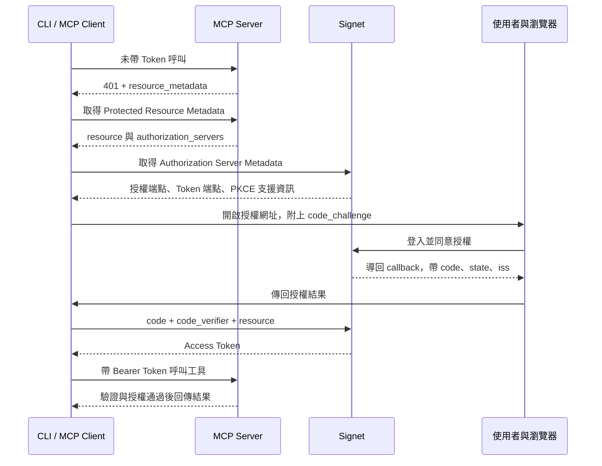
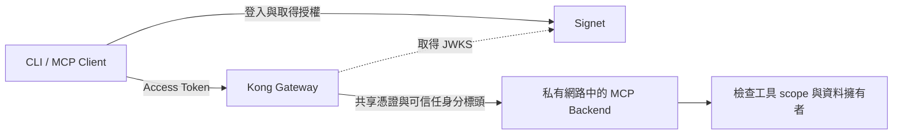

2026 年 10 月 14 日，我在 [Hello World Dev Conference 2026][event] 帶了一場 90 分鐘的實作工作坊：「讓 AI Agent、MCP Server、CLI 安全登入」。這篇文章把工作坊的觀念與練習路線整理下來，讓沒到場的朋友也能從自己的筆電開始，走過一次 MCP 的授權流程。

當 Agent 能讀文件、查工單、寫入資料，接上工具只是開始。真正要回答的是：**這次操作代表誰？可以做哪些事？這顆 Token 能用在哪個服務？出事後，要怎麼停止它的權限？**

上一篇[企業身分認證治理實戰][governance-post]談的是整體架構，這篇則把焦點拉近到一個 HTTP 請求：從沒有 Token 時的 `401`，一路追到登入、取得授權，以及 Server 決定接受或拒絕的那一刻。

<!--more-->

## 活動與教材

[](/images/2026-10-18/lab-roadmap.png)

*主課依序完成 Lab 01–04、06，Lab 05 的撤銷練習留作課後選修。（[原投影片第 3 頁](https://appleboy.github.io/slides/2026/1014-hwdc-workshop/workshop-zh.html#s3)，可點圖放大。）*

| 項目 | 內容 |
| --- | --- |
| 活動 | Hello World Dev Conference 2026 |
| 本篇對應場次 | 2026 年 10 月 14 日，13:30–15:00；13:00–13:30 為環境準備 |
| 地點 | 臺北文創大樓 6 樓，605＋606 會議室 |
| 講者 | 吳柏毅（Bo-Yi Wu / appleboy） |
| 實作語言 | Go 或 Python，選一條路線即可 |
| AI Client | Claude Code 或 Codex CLI |

完整資料可以搭配閱讀：[公開投影片][slides]與 [Workshop Repo][repo]。活動頁也列有 10 月 15 日的同內容場次。

本文的操作順序以公開投影片與目前 repo 為準：**Lab 01 → 02 → 03 → 04 → 06**，Lab 05 的撤銷練習留作課後選修。活動簡介原先提到的 Device Flow 與即時撤銷演練，和目前教材有所不同；本文會依實作說明限制，不把規劃中的能力當成範例已具備的功能。

## 先把角色分清楚：誰登入，誰發 Token，誰驗證？

[](/images/2026-10-18/roles.png)

*Client 發起授權，Signet 簽發 Token，MCP Server 驗證並執行資源授權。（[原投影片第 2 頁](https://appleboy.github.io/slides/2026/1014-hwdc-workshop/workshop-zh.html#s2)，可點圖放大。）*

「讓 MCP Server 安全登入」是容易理解的說法，但在這份教材裡，MCP Server 扮演的是 **OAuth Resource Server**：它提供工具與資料，檢查呼叫者帶來的 Access Token，再決定允不允許操作。

真正引導使用者登入、取得 Token 的，是 Client。一次完整流程有四個參與者：

| 角色 | 本次使用的元件 | 責任 |
| --- | --- | --- |
| Client | AI CLI 或教材的參考 Client | 發起授權、處理回呼、取得並保存 Token |
| 使用者與瀏覽器 | 你開啟的登入頁 | 登入帳號，確認 App 與要求的權限 |
| Authorization Server | Signet | 驗證身分、取得同意、簽發 Token |
| Resource Server | Go / Python MCP Server | 驗證 Token，執行工具與資料的權限檢查 |



這裡談的是教材中的 **HTTP MCP 授權**。不要直接把這套網路登入流程套到所有本機 stdio MCP，也不要把 MCP 的連線狀態當成使用者已取得資源授權。

## Lab 01：先看沒有授權的 MCP 會發生什麼事

[](/images/2026-10-18/unprotected-mcp.png)

*能連到服務不應等於能使用所有工具；Lab 01 刻意展示未加保護的起點。（[原投影片第 4 頁](https://appleboy.github.io/slides/2026/1014-hwdc-workshop/workshop-zh.html#s4)，可點圖放大。）*

教材提供三個工具：`whoami`、`list_notes`、`create_note`。第一關刻意不檢查 Token，能連到服務的程式就能呼叫工具，包含新增筆記。

這個起點很有用：我們可以先確認工具能正常運作，再觀察加入授權後，哪些請求應該繼續成功、哪些必須被拒絕。筆記只存在記憶體，重啟就會清空，適合拿來練習。

整份 repo 已經是可執行的完成版，每關都有自己的入口，不必一邊上課一邊手刻 OAuth 或 JWT。練習的重點，是看懂每個請求和回應背後的判斷。

## Lab 02：401 也是登入流程的入口

[](/images/2026-10-18/discovery-metadata.png)

*兩份 metadata 串起資源識別、信任的 issuer 與取得授權的端點。（[原投影片第 5 頁](https://appleboy.github.io/slides/2026/1014-hwdc-workshop/workshop-zh.html#s5)，可點圖放大。）*

Client 第一次連到受保護的 MCP Server，可能還不知道要去哪裡取得授權。Server 可以透過 `WWW-Authenticate` 告訴它 Protected Resource Metadata（PRM）的位置。以本機教材為例，回應的關鍵部分如下：

```http
HTTP/1.1 401 Unauthorized
WWW-Authenticate: Bearer resource_metadata="http://localhost:8000/.well-known/oauth-protected-resource/mcp"
```

Client 接著讀取 PRM，得到這個資源的識別與它信任的 Authorization Server：

```json
{
  "resource": "http://localhost:8000/mcp",
  "authorization_servers": ["https://signet.wu-boy.com"]
}
```

再依 issuer 取得 Authorization Server Metadata，找到 `authorization_endpoint`、`token_endpoint`、`jwks_uri`，以及是否支援 PKCE 的 `S256`。Client 也要確認 metadata 裡的 issuer 與原先選定的值一致。

這兩份 metadata 各自回答一個問題：**PRM 告訴你這個資源接受誰發的 Token；授權伺服器的 metadata 告訴你如何取得 Token。** PRM 是資源端提供的 metadata，不需要為它另外架一台認證服務。

Lab 02 只做到 discovery，因此即使帶了有效 Token，仍然會回 `401`。這是刻意保留的教學階段，要進入 Lab 03 才會接受並驗證 Token。流程可對照[投影片中的 discovery 說明][slides]。

## Lab 03：CLI 沒有 client secret，如何安全取得 Token？

[](/images/2026-10-18/pkce.png)

*授權時送出 challenge，換 Token 時才提出 verifier，讓授權碼綁定發起流程的 Client。（[原投影片第 7 頁](https://appleboy.github.io/slides/2026/1014-hwdc-workshop/workshop-zh.html#s7)，可點圖放大。）*

安裝在使用者電腦上的 CLI，無法把內建的共用密碼當成可靠祕密。這份教材把它當作 **public Client**，先在 Signet 註冊 App，取得公開的 Client ID，再使用 Authorization Code + PKCE。

Client ID 的用途是辨識 App；它不是密碼，也不代表持有它就擁有某位使用者的權限。

PKCE 的核心，是把授權碼的兌換綁定到發起流程的 Client：

1. Client 產生隨機的 `code_verifier`，保留在自己手上。
2. 對 verifier 做 SHA-256 與 base64url 編碼，得到 `code_challenge`。
3. 開啟授權網址時，只送出 challenge，並指定 `code_challenge_method=S256`。
4. 使用者登入並同意後，瀏覽器帶回的是授權碼 `code`。
5. Client 用 `code` 與原本的 verifier 向 Token endpoint 交換 Token；Signet 檢查是否符合先前的 challenge。

攔截到授權碼的人，如果沒有對應的 verifier，就無法完成這次交換。教材還會驗證 `state`，並依授權伺服器宣告的支援情況檢查回呼的 `iss`，避免把不同登入流程或不同 issuer 的回應混在一起。實作細節見 [Lab 03][lab03]。

**瀏覽器登入完成，不代表下一個 HTTP 請求自動帶有權限。** Client 每次呼叫受保護的 MCP，都還是要附上 Access Token。此時另外執行沒有 Token 的 `curl`，收到 `401` 才是正確結果。

### Server 不能只把 JWT 解開來看

[](/images/2026-10-18/token-validation.png)

*解碼不等於驗證；確認 Token 可信且適用於這個服務，才能繼續檢查權限。（[原投影片第 10 頁](https://appleboy.github.io/slides/2026/1014-hwdc-workshop/workshop-zh.html#s10)，可點圖放大。）*

解碼 JWT payload 只能讀到內容，不能證明它可信。本教材使用 RS256 與 JWKS 公鑰驗證，並檢查下列條件：

| 檢查 | 要確認的事情 |
| --- | --- |
| 簽章 | Token 是否由信任的金鑰簽發、內容是否遭竄改 |
| `iss` | 是否來自預期的 Signet issuer |
| `aud` | 是否發給目前這個 MCP resource 使用 |
| `exp` | 是否仍在有效期限內 |
| `type` | 在 Signet 的 Token 格式中，必須是 `access` |
| `sub` | 是否有可用的使用者識別，供後續資料隔離使用 |

驗證通過之後，還要繼續檢查 scope 與業務權限。JWT、RS256 和 `type=access` 是這份教材的具體選擇，不能解讀成所有 MCP 實作都必須使用相同 Token 格式。[教材的設計取捨][repo]也特別說明了這點。

## Lab 04：權限、服務與使用者，是三條不同的邊界

[](/images/2026-10-18/scope-audience.png)

*Token 不被接受與權限不足，是兩種不同的拒絕原因。（[原投影片第 11 頁](https://appleboy.github.io/slides/2026/1014-hwdc-workshop/workshop-zh.html#s11)，可點圖放大。）*

這一關最值得動手做，因為「有 Token」很容易讓人誤以為授權已經完成。實際上，Server 還必須回答三個問題。

### scope：讀得到，不代表寫得進去

教材使用 `notes:read` 控制入口，`create_note` 另外要求 `notes:write`。只有讀取權限的 Token 可以列出筆記，但新增筆記應被拒絕。

重新授權取得讀寫權限之後，必須改用新 Token。原本的 read-only Token 不會因為使用者在別處按過同意，就自動長出寫入權限。

### resource / audience：A 的 Token，不能拿去打 B

教材把 Server A 與 B 分別放在 `http://localhost:8000/mcp` 和 `http://localhost:8001/mcp`。Client 取得授權時用 `resource` 指定目標，Server 收到 Token 時則驗證 `aud` 是否適用於自己。

即使是同一個帳號、相同的 scope，發給 A 的 Token 仍然不能拿去存取 B。這可以避免一顆 Token 在不同服務之間被任意挪用。

### subject：同樣能讀，也不代表能讀別人的資料

兩個人都擁有 `notes:read`，不代表兩個人可以看到彼此的筆記。教材在同一個 Server 裡依 `subject` 隔離資料；第二帳號的練習，是為了驗證這條邊界。

把結果放在一起看，就容易區分 `401` 和 `403`：

| 測試情境 | 教材預期結果 | 原因 |
| --- | --- | --- |
| 不帶 Token、Token 過期或驗證失敗 | `401` | Server 無法接受這份憑證 |
| 拿 A 的 Token 呼叫 B | `401` | audience 不符合目前的資源 |
| 只有讀取權限，卻新增筆記 | `403 insufficient_scope` | Token 有效，但缺少寫入權限 |
| 使用適用於 A 的讀寫 Token，在 A 新增筆記 | `200` | 驗證及工具授權通過 |
| 第二個帳號列出自己的筆記 | `200` | 操作合法，但結果不能包含第一個帳號的資料 |

這些是 [Lab 04][lab04] 要驗證的結果。**授權測試不能只看成功路徑，也要確認不該成功的操作確實沒有改動資料。**

## 在自己的筆電跑一次

先準備 Git、curl，以及 Go 1.26／1.27，或 Python 3.12 搭配 uv；Windows 使用 WSL2。版本與安裝需求以 [repo 的課前清單][repo]為準。以下選 Go 示範，Python 路線可依教材換用 `python`。

```bash
git clone https://github.com/go-training/mcp-oauth2-workshop.git
cd mcp-oauth2-workshop
cp .env.example .env
chmod 600 .env
```

依照 [Signet Client App 指引][client-app]建立並確認 App 為 active，設定允許的 scopes、resources 與 redirect URI，再把自己的 `OAUTH_CLIENT_ID` 填入 `.env`。參考 Client 使用的 callback 是 `http://127.0.0.1:8765/callback`，需要事先註冊；AI CLI 的回呼設定則請依各自的[連線指引][clients]處理。

`SIGNET_ISSUER` 使用教材預設的 `https://signet.wu-boy.com`，結尾不加斜線。`GATEWAY_SHARED_SECRET` 先留空，進入 Lab 06 才設定。

安裝依賴：

```bash
(cd go && go mod download)
# Python 路線則使用：uv sync --project python --frozen
```

每開一個新終端，都要在 repo 根目錄載入環境變數；腳本不會自動讀 `.env`：

```bash
set -a
source .env
set +a
```

先在終端 A 啟動 Lab 01：

```bash
./scripts/lab.sh 01 go
```

在終端 B 呼叫未受保護的服務。首次練習時，使用尚不存在的 Token 檔名即可觀察匿名呼叫：

```bash
./scripts/oauth.sh go call --token-file .tokens/anonymous.json
```

確認工具回應正常後，依序閱讀 [Lab 02][lab02]。每次換關，都先在終端 A 按 `Ctrl-C` 停止舊 Server，再啟動下一關；Go 與 Python 預設都使用 port 8000，不能同時占用。

進入 Lab 03，在終端 A 啟動驗證 Token 的 Server：

```bash
./scripts/lab.sh 03 go
```

終端 B 執行登入，開啟它顯示的網址並完成授權：

```bash
./scripts/oauth.sh go login --scopes notes:read --token-file .tokens/lab03-read.json
```

等終端顯示 `Saved access token`，再執行工具呼叫：

```bash
./scripts/oauth.sh go call --token-file .tokens/lab03-read.json --tool whoami
```

預期取得 `200`，並看到自己的 `subject`。同時執行 `curl -i http://localhost:8000/mcp` 仍應得到 `401`，因為這個請求沒有附上 Token。

接著依 [Lab 04][lab04] 驗證 read-only 寫入失敗與 A/B audience 隔離。用參考 Client 看懂行為後，再依 [AI CLI 設定指引][clients]把相同服務接到日常工具，會更容易定位問題。

Token 檔使用 `0600` 權限，已被 Git 忽略；請勿將完整 Token 貼進聊天或截圖。重跑登入時改用新的檔名，教材的 Client 會拒絕覆寫既有檔案。

## Lab 06：服務變多後，把入口驗證集中到 Gateway

[](/images/2026-10-18/gateway.png)

*Gateway 集中入口驗證，後端仍要守住工具權限、資料隔離與信任邊界。（[原投影片第 14 頁](https://appleboy.github.io/slides/2026/1014-hwdc-workshop/workshop-zh.html#s14)，可點圖放大。）*

前面幾關由 MCP Server 自己驗 Token。當服務變多，重複維護 discovery、驗簽與入口 scope 檢查，就會開始有成本。

Lab 06 加入 Kong 與 `mcp-oauth2` plugin，讓 Gateway 提供 PRM、驗證 JWT 並檢查入口所需的 `notes:read`；後端保留工具與資料授權。



Client 此時要為 Gateway 對外的 resource（教材是 `http://localhost:9000/mcp`）取得 Token。**Kong 不會代替使用者登入**；登入仍由 Client 與 Signet 完成。

這個設計還有一道不能省略的信任邊界：backend 不對外發布 port，並檢查 Gateway 共享憑證與身分標頭。不能因為請求寫了 `X-MCP-Subject: admin`，就相信它是管理員。Gateway 也必須正確處理外部傳入的身分標頭，避免把偽造資訊傳給後端。

只有 `notes:read` 的請求可以通過入口，但呼叫 `create_note` 時，backend 仍應因缺少 `notes:write` 回傳 `403`。這正是集中驗證之後，服務仍需保留的責任。

如果只有一個 MCP Server，自行驗證仍然合理。Gateway 帶來集中管理，也多了一個要部署、維運與保護的服務。想操作這一關，請先完成 [Lab 06 的 Docker Compose 與映像建置準備][lab06]。

## 課後 Lab 05：撤銷成功，為什麼同一顆 Token 還能用？

[](/images/2026-10-18/revocation.png)

*撤銷不會改變已簽發 JWT 的簽章；即時拒絕需要額外的撤銷狀態檢查或傳播機制。（[原投影片第 17 頁](https://appleboy.github.io/slides/2026/1014-hwdc-workshop/workshop-zh.html#s17)，可點圖放大。）*

這是整場工作坊最容易產生誤解的地方。教材中的 MCP Server 與 Kong plugin 都是**離線驗證 JWT**：它們檢查簽章與 claims，不會每次呼叫都向 Signet 查詢 Token 的撤銷狀態。

在授權伺服器撤銷一顆 Token，不會改變已簽發 JWT 的內容與簽章。因此，只要仍未過期，離線驗證的一端就可能繼續接受它。[Lab 05][lab05]刻意讓你撤銷後再拿同一顆 Token 呼叫，觀察這個差異。

此外，撤銷 endpoint 回傳 `200`，也不能單獨證明資源端已經拒絕它；未知或已撤銷的 Token 也可能得到成功回應。

如果業務要求事件發生後立即停止存取，就要另外設計 introspection 或撤銷狀態的傳播機制，並決定快取多久、查詢失敗時怎麼處理。縮短 Access Token 的有效期限可以縮小暴露時間，但不等於立即撤銷。引入 Gateway，也不會自動消除這個限制。

Device Flow 則是目前教材的延伸主題，不在主課實作內。它可讓使用者換到另一個瀏覽器完成授權，仍然需要人參與，不能直接當作無人值守 CI 的身分方案。

## 把這套練習帶回自己的服務

[](/images/2026-10-18/takeaways.png)

*把成功與拒絕情境都變成驗收條件，才能確認授權邊界符合預期。（[原投影片第 18 頁](https://appleboy.github.io/slides/2026/1014-hwdc-workshop/workshop-zh.html#s18)，可點圖放大。）*

我希望大家帶走的，是能判斷「這次請求為什麼應該被接受，或為什麼必須被拒絕」的能力。從 HTTP 回應往回追，確認 discovery 是否正確、PKCE 是否完成、Token 是否適用於這個 resource，再檢查工具與資料權限，就能把模糊的「登入壞了」拆成可以驗證的問題。

替自己的 MCP 加上授權時，也可以沿用教材的幾個驗收情境：沒有 Token 不能進、read-only 不能寫、A 的 Token 不能用在 B、使用者不能看到彼此的資料，以及撤銷後的實際行為符合系統承諾。

AI Agent 可以更快地執行操作，我們也要讓每次操作的身分、權限與有效期限足夠清楚。從一個小小的筆記工具開始，把這些邊界驗證一次，再把同樣的方法帶到公司的工單、文件與內部系統。

[完整投影片][slides]與[實作教材][repo]都已公開，可以依自己的語言與工具習慣選一條路線練習。

[event]: https://hwdc.ithome.com.tw/2026/lab/4993
[slides]: https://appleboy.github.io/slides/2026/1014-hwdc-workshop/workshop-zh.html
[repo]: https://github.com/go-training/mcp-oauth2-workshop
[governance-post]: /2026/10/ai-identity-auth-governance-zh-tw/
[client-app]: https://github.com/go-training/mcp-oauth2-workshop/blob/main/docs/signet-client-app.md
[clients]: https://github.com/go-training/mcp-oauth2-workshop/blob/main/docs/clients.md
[lab02]: https://github.com/go-training/mcp-oauth2-workshop/blob/main/labs/02/README.md
[lab03]: https://github.com/go-training/mcp-oauth2-workshop/blob/main/labs/03/README.md
[lab04]: https://github.com/go-training/mcp-oauth2-workshop/blob/main/labs/04/README.md
[lab05]: https://github.com/go-training/mcp-oauth2-workshop/blob/main/labs/05/README.md
[lab06]: https://github.com/go-training/mcp-oauth2-workshop/blob/main/labs/06/README.md
