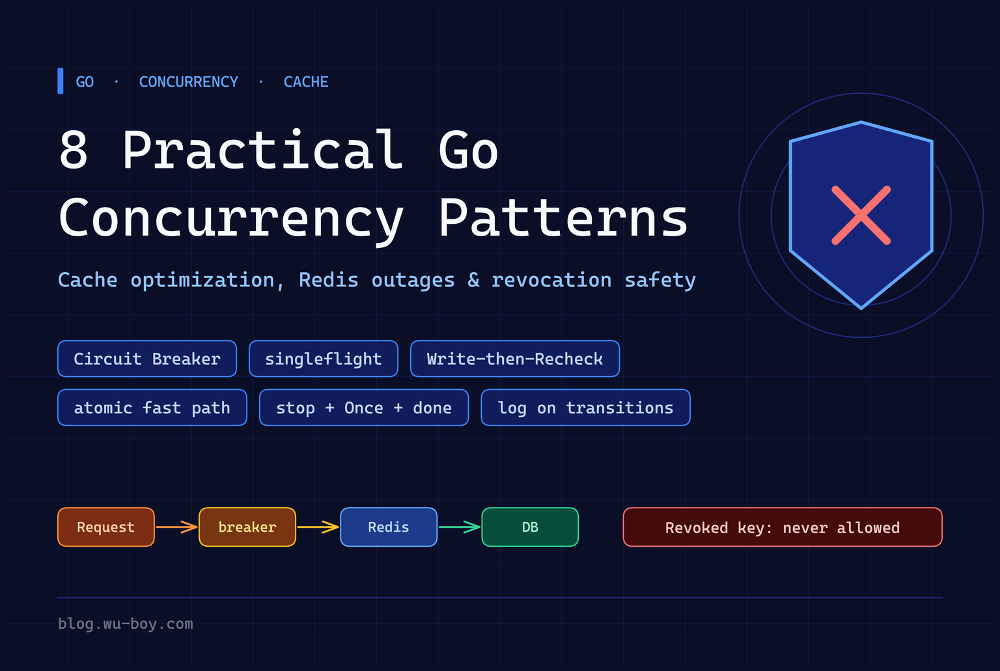
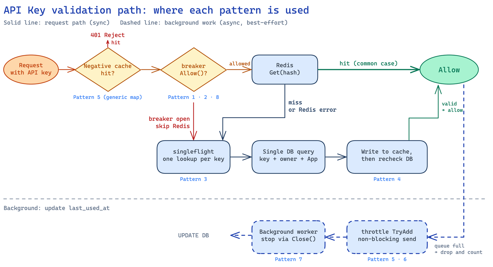
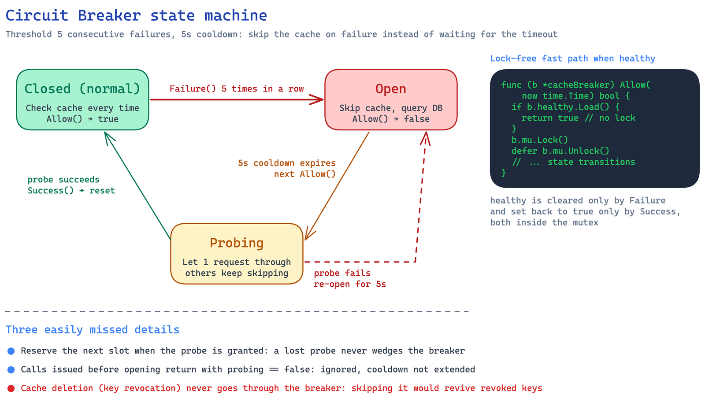
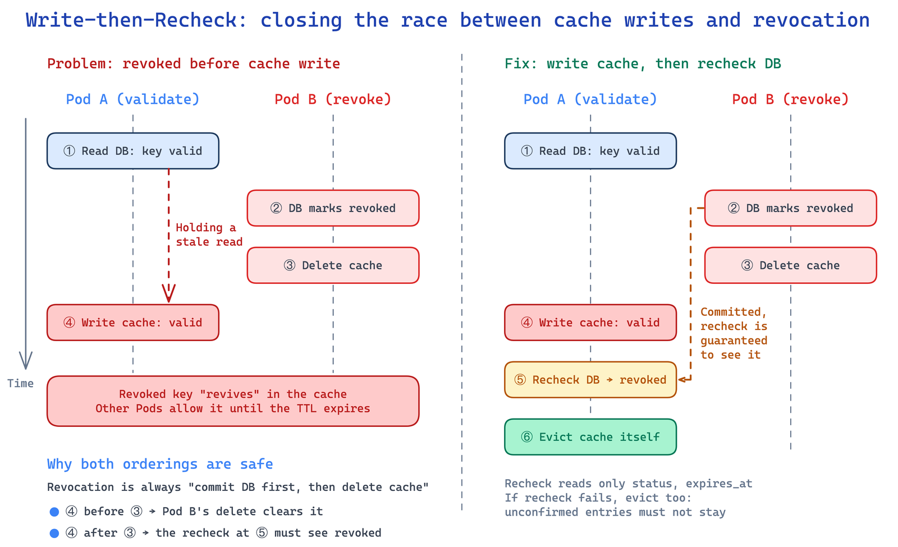
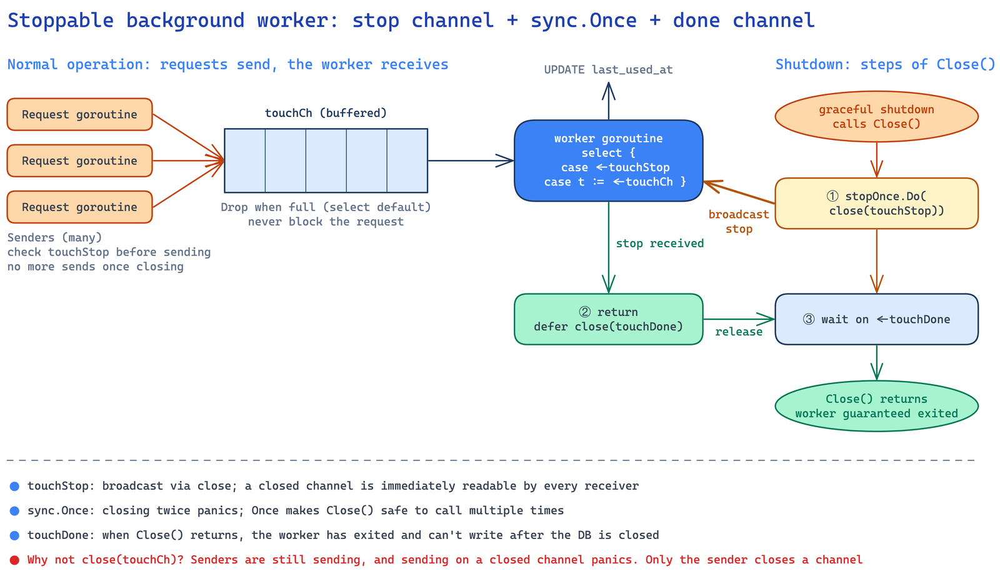

This article is drawn from a performance improvement to an authorization service written in Go. The subject is API key validation caching: how to shorten the query path on a cache miss, how to keep every request from being dragged down when Redis fails, and how to shut down background workers correctly. The code comes from a real project; I trimmed it for readability and renamed things to be generic.

On the surface these are 8 independent Go patterns, but they serve one goal: **under cache degradation, Redis failure, and service shutdown, hold the line that "a revoked key must never be allowed through" while still winning back latency and throughput.** Near the end, a Redis outage timeline strings all 8 patterns together on one request path.

<!--more-->

## Background: Every API Request Must Validate a Key

When a user calls the API with an API key, the server must confirm that:

1. The key exists, has not been revoked, and has not expired
2. The owner's account is still active
3. The owning App is still active and allows API keys

This data lives across three tables: `api_keys`, `users`, and `apps`. Querying the DB on every request is too expensive, so a Redis cache sits in front. The diagram below shows the full validation path and marks where each pattern in this article is used.



### The Safety Line Running Through This Article

Before the patterns, here is one invariant: **a revoked key must never be allowed through.**

- **The cache is only an optimization; the DB decides correctness.** When Redis fails or is bypassed, falling back to the DB gives the same correct answer, so cache reads and writes can fail open (skip the cache and query the DB).
- **The revocation path must not fail open to a stale cache.** An "allowed" entry left in the cache after revocation is a back door for a revoked key. So deleting from the cache must never be blocked by any degradation mechanism (Pattern 1), and a cache write must be followed by a DB recheck (Pattern 4).

Every pattern below trades for lower latency and higher throughput without breaking this line.

The code review of the previous implementation raised three problems:

- A cache miss required several DB queries
- Once Redis failed, **every** request waited for the Redis timeout before falling back
- The background worker that updates `last_used_at` could not be shut down, and its throttle had a race

The code in this article uses a few constants whose definitions are not shown. Here are their actual values in the project, so you don't have to guess later:

```go
const (
	breakerThreshold = 5                // consecutive failures before the breaker opens
	cooldown         = 5 * time.Second  // cooldown after the breaker opens
	ttl              = 30 * time.Second // validation cache TTL (default 30s, max 60s)
	fillTimeout      = 15 * time.Second // upper bound of the shared singleflight query
	interval         = time.Minute      // throttle interval for last_used_at
	touchQueueSize   = 1024             // capacity of the background update queue
)

// Labels for a cache lookup result: hit, miss, bypass.
// bypass means the cache was not used this time (breaker open, canceled,
// or cache failing) and the request went straight to the DB.
```

The article has two parts:

- **Patterns 1–4: caching and consistency.** How to degrade on failure, how to coalesce hot keys, and how to close the race between caching and revocation.
- **Patterns 5–8: concurrency and lifecycle.** How to avoid check-then-act races, how to keep background work from slowing requests, how to shut goroutines down properly, and how to handle logging and error classification during failures.

## Part 1: Caching and Consistency (Patterns 1–4)

### Pattern 1: Circuit Breaker, Fail Fast When a Dependency Is Down

The cache exists only for speed. If Redis is down, falling back to the DB still gives correct results. The problem is purely **latency**: every request is stuck behind the Redis timeout.

The idea of a circuit breaker is simple: after too many consecutive failures, stop calling the dependency for a while.



No third-party package is needed; it fits in under 100 lines:

```go
type cacheBreaker struct {
	healthy   atomic.Bool // see Pattern 2
	mu        sync.Mutex
	threshold int
	cooldown  time.Duration
	failures  int
	open      bool
	openUntil time.Time // earliest time the next probe may be let through
	probing   bool      // a probe was let through and has not reported back
}

func (b *cacheBreaker) Allow(now time.Time) bool {
	if b.healthy.Load() {
		return true
	}
	b.mu.Lock()
	defer b.mu.Unlock()
	if !b.open {
		return true
	}
	if now.Before(b.openUntil) {
		return false
	}
	// Let one probe through, and push the next probe time back immediately
	b.probing = true
	b.openUntil = now.Add(b.cooldown)
	return true
}
```

#### Detail 1: Reserve the probe slot when it is granted

When `Allow` lets a probe through, it immediately pushes `openUntil` forward. If you instead wait for the probe to report failure before updating the time, a canceled probe request (for example, the client disconnected) never reports back, and the breaker believes a probe is still running and never lets another through. **Reserve the next slot at the moment of granting**, so even if the probe is lost, the next one is allowed once the cooldown ends.

#### Detail 2: Failures from calls issued before opening must not extend the cooldown

```go
func (b *cacheBreaker) Failure(now time.Time) (opened bool) {
	b.mu.Lock()
	defer b.mu.Unlock()
	b.healthy.Store(false)
	if b.open {
		if !b.probing {
			return false // call issued before the breaker opened: ignore
		}
		b.probing = false
		b.openUntil = now.Add(b.cooldown) // probe failed: re-open
		return true
	}
	b.failures++
	if b.failures < b.threshold {
		return false
	}
	b.open = true
	b.openUntil = now.Add(b.cooldown)
	return true
}
```

Right after Redis dies, thousands of requests may be waiting on the timeout. They fail one after another after the breaker has opened; if each one pushed the cooldown back, the breaker would stay open forever. The `!b.probing` check filters these stale calls out.

#### Detail 3: Gate reads and writes, never deletes

When a key is revoked, its "allowed" entry must be deleted from the cache. **Deletion must never be blocked by the breaker.** If deletes were skipped while the breaker is open, a revoked key would still be allowed by the cache after Redis recovers. That is a security problem, so the cache-deletion path bypasses the breaker entirely.

> Principle: a breaker protects operations that are safe to skip. An operation that would produce a wrong result if skipped must not be left to the breaker.

### Pattern 2: A Lock-Free Fast Path with atomic (Mutex + atomic.Bool)

With the breaker in place, every validation calls `Allow()` and `Success()`. While Redis is healthy, both originally took the same mutex. At high RPS, all requests fight over a lock they don't need, because the state never changes.

The fix is an `atomic.Bool` used as a "fully healthy" flag:

```go
func (b *cacheBreaker) Success() {
	if b.healthy.Load() {
		return // healthy: return without locking
	}
	b.mu.Lock()
	defer b.mu.Unlock()
	b.failures = 0
	b.open = false
	b.probing = false
	b.openUntil = time.Time{}
	b.healthy.Store(true)
}
```

There are only two invariants, documented in the struct comment:

1. Only `Failure` sets `healthy` to false
2. Only `Success` sets it back to true

Both modify it inside the mutex. The fast path merely **reads** an atomic, while every state transition is still protected by the mutex.

What about races? Suppose `Success` has just read `healthy == true` while another goroutine runs `Failure`. This `Success` doesn't reset the failure count, which is equivalent to "Success happened before Failure". That is one of the valid orderings and does not corrupt state.

> Principle: when the common path doesn't change state, skip the lock by reading an atomic flag, and keep every write under the lock. The key is to state clearly who is allowed to change the flag.

### Pattern 3: singleflight + `context.WithoutCancel`, Shared Work Must Not Be Canceled by One Caller

When 100 requests miss the cache on the same hot key at once, there is no need for 100 DB queries. `golang.org/x/sync/singleflight` coalesces concurrent calls for the same key into one (for the basics of singleflight and the hot-key cache invalidation problem, see my earlier post: [Using singleflight in Go language to solve Cache Hotspot Invalid](/2024/02/how-to-reslove-the-hotspot-invalid-using-singleflight-en/)):

```go
func (s *KeyService) loadValidatedState(
	ctx context.Context,
	hash string,
) (keyFill, error) {
	if err := ctx.Err(); err != nil {
		return keyFill{}, err
	}
	resultCh := s.lookupGroup.DoChan(hash, func() (any, error) {
		fillCtx, cancel := context.WithTimeout(
			context.WithoutCancel(ctx), // don't inherit the caller's cancellation
			fillTimeout,                // but have its own upper bound
		)
		defer cancel()
		return s.fillValidatedState(fillCtx, hash)
	})

	select {
	case <-ctx.Done(): // each caller still honors its own context
		return keyFill{}, ctx.Err()
	case result := <-resultCh:
		// ...
	}
}
```

There are two easy traps here:

**Trap 1: using `Do` instead of `DoChan`.** `Do` blocks until the result is ready, so a canceled caller context cannot leave early. `DoChan` returns a channel that you can `select` on together with `ctx.Done()`.

**Trap 2: passing the caller's ctx straight into the shared function.** The shared DB query runs with the ctx of the first request in (the leader). If that user disconnects, the query is canceled and **the other 99 waiters all fail together**.

`context.WithoutCancel`, added in Go 1.21, solves exactly this: it keeps the values in ctx (trace ID, logger, and so on) but cuts the cancellation signal. `WithTimeout` then gives the shared work an independent upper bound so it can't run forever.

Note the scope of singleflight: it coalesces requests **within a single process** only. When multiple Pods miss the same key at once, each Pod still queries the DB once. It solves duplicate queries inside a process, not coordination across Pods; this limit comes back in "Unsolved Problems" at the end.

> Principle: decouple shared work from the lifecycle of any single caller, but give it its own timeout; each caller decides for itself whether to keep waiting.

### Pattern 4: Write-then-Recheck, Closing the Revocation Race

This is the part of the change that needs the most careful thought. Consider two Pods doing two things at the same time:



The left half is the problem: when Pod A reads the DB the key is still valid, but by the time it writes to Redis the key has been revoked, and Pod B's delete finished long ago. The cache is left with an "allowed" entry for a revoked key until the TTL expires.

The right half is the fix: **after writing to the cache, read the DB again.**

```go
func (s *KeyService) cacheValidatedState(
	ctx context.Context,
	hash string,
	state *ValidatedKeyState,
) string {
	if err := s.cache.Set(ctx, hash, *state, ttl); err != nil {
		s.recordCacheFailure(ctx, "set", err)
		return ""
	}

	fresh, err := s.store.GetKeyLifecycleByHash(ctx, hash)
	switch {
	case err == nil && fresh.Status == StatusActive &&
		!fresh.IsExpiredAt(time.Now()):
		return "" // still valid
	case err == nil && fresh.Status == StatusRevoked:
		s.evictCache(ctx, hash)
		return "revoked"
	// ... expired and not-found are handled the same way
	default:
		// The DB read behind this allow is already authoritative, so we still allow;
		// but an entry we can't verify must not outlive the failed check
		s.evictCache(ctx, hash)
		return ""
	}
}
```

Why is this safe? Revocation always **commits the DB first, then deletes from the cache**. So Pod A's write can only land in one of two places:

- **The write comes before the delete**: Pod B's delete clears it
- **The write comes after the delete**: the DB commit is long done, so Pod A's recheck is guaranteed to see `revoked` and evicts the entry itself

Neither ordering lets a revoked key **stay** in the cache until the TTL expires.

The `default` branch at the end of the code deserves an explanation too: when the recheck itself fails (for example, the DB is briefly unreachable), the request is still allowed. The reason is that the allow is based on the "valid" result read from the DB in the previous step, which is authoritative on its own. But the entry we just wrote can no longer be confirmed as valid, so we evict it; it must not outlive the failed check.

#### The Boundaries of This Guarantee

This approach guarantees that "a resurrected key cleans itself up", not that "there is no window at all". Three points to be clear about:

1. **A short window remains.** Between ④ writing the cache and ⑥ evicting it, other Pods' requests may read this stale "allowed" entry. The window is bounded by the time of one DB recheck instead of the whole TTL. If your business cannot tolerate even that, you need immediate invalidation on revoke, or a shorter cache TTL.
2. **The recheck must read fresh data.** It must read from the primary, not from a read replica with replication lag. If the replica hasn't caught up to `revoked`, the recheck sees the old state and the argument above no longer holds.
3. **If the delete on revoke fails, only the TTL converges it.** Deletion bypasses the breaker, but when Redis is truly unreachable, the delete itself still fails. A revoked key can then be allowed for up to the TTL, so the TTL length is the last upper bound on this safety line. In this project the TTL defaults to 30 seconds with a maximum of 60 seconds; the delete on revoke is retried twice, and only if it still fails is an ERROR logged and the TTL left to converge it.

#### The recheck reads only the fields it needs

The recheck only needs to confirm "can this key still be used", so a separate query reads just `status` and `expires_at` rather than the whole row:

```go
type KeyLifecycle struct {
	Status    string    `gorm:"column:status"`
	ExpiresAt time.Time `gorm:"column:expires_at"`
}
```

This is a small dedicated struct rather than a full model with only two fields populated, so callers can't accidentally use fields that were never filled in.

> Principle: "write the DB, then delete the cache" combined with "write the cache, then recheck the DB". Each side guarantees one direction, and together they shrink the window from "the whole TTL" to "one recheck". This assumes the recheck reads fresh data.

## Part 2: Concurrency and Lifecycle (Patterns 5–8)

These four patterns look unrelated to caching at first, but they hold up the same request path: throttling, background writes, shutdown, and logging during failures. After them, the "Redis outage timeline" near the end ties them together with the first four.

### Pattern 5: Atomic Check-and-Set to Eliminate TOCTOU

`last_used_at` is display-only data, so updating each key at most once per interval is enough. The original code was:

```go
// racy version
if s.touchThrottle.Has(key.ID, now) {
	return
}
s.touchThrottle.Add(key.ID, now.Add(interval))
// send the update...
```

`Has` and `Add` each take the lock, but **there is no lock held between the two calls**. Two goroutines can both pass `Has` and then both send an update. This is the classic TOCTOU (time-of-check to time-of-use).

The fix is to put the check and the write in the same critical section:

```go
// TryAdd writes only if the key is absent or expired, and reports whether it wrote.
func (m *boundedTTLMap[V]) TryAdd(key string, value V, now, expiresAt time.Time) bool {
	m.mu.Lock()
	defer m.mu.Unlock()

	if existing, ok := m.entries[key]; ok && now.Before(existing.expiresAt) {
		return false
	}
	m.setLocked(key, value, expiresAt)
	return true
}
```

The call site becomes one line:

```go
if !s.touchThrottle.TryAdd(key.ID, now, now.Add(interval)) {
	return
}
```

This is also a good example of generics. `boundedTTLMap[V]` is a capacity-bounded map whose entries expire: the negative cache (remembering keys that don't exist or were revoked) needs to store values, while the throttle only needs to know "present or not". Both share one implementation, and `boundedTTLSet` is just a thin wrapper over `boundedTTLMap[struct{}]`.

Note also the `setLocked` naming convention: the `Locked` suffix means "the caller must already hold the lock". `Add` and `TryAdd` share this write logic without locking twice.

> Principle: for check-then-act to hold, both steps must happen under the same lock. Providing a `TryXxx` method is far safer than letting callers combine `Has` + `Add` themselves.

### Pattern 6: Non-Blocking Send, Roll Back on Failure

`last_used_at` updates are thrown onto a background channel, and a worker writes them to the DB. The request path **must never** block because the queue is full:

```go
func (s *KeyService) touchLastUsed(key *APIKey, now time.Time) {
	select {
	case <-s.touchStop: // already shutting down: don't send
		return
	default:
	}
	if !s.touchThrottle.TryAdd(key.ID, now, now.Add(interval)) {
		return
	}
	select {
	case s.touchCh <- touchRequest{keyID: key.ID, now: now}:
	default:
		// queue full: drop, and undo the throttle so the next request can still update
		s.touchThrottle.Delete(key.ID)
		s.metrics.RecordTouchDropped()
		return
	}
	setTouchQueueLength(len(s.touchCh))
	key.LastUsedAt = &now
}
```

Three key points:

1. **`select` + `default`** makes the send non-blocking: when the queue is full, drop instead of slowing the request.
2. **Roll back the throttle on drop.** Otherwise the key won't try to update again for the whole interval, losing an update for nothing.
3. **Count drops** (for example, `touch_dropped_total`). Best-effort doesn't mean silently losing data; operators need to see it.

> Principle: use a non-blocking send for best-effort background work; when you drop, give back the resources you claimed earlier and leave a metric.

### Pattern 7: A Stoppable Background Worker, stop channel + `sync.Once` + done channel

The original worker was `for touch := range s.touchCh`, which can't be stopped once started. It now uses the standard trio:



```go
type KeyService struct {
	touchCh       chan touchRequest
	touchStop     chan struct{} // tells the worker to stop
	touchDone     chan struct{} // the worker has really exited
	touchStopOnce sync.Once     // makes Close safe to call repeatedly
}

func (s *KeyService) touchWorker() {
	defer close(s.touchDone)
	for {
		select {
		case <-s.touchStop:
			return
		case touch := <-s.touchCh:
			setTouchQueueLength(len(s.touchCh))
			s.writeTouch(touch)
		}
	}
}

// Close stops the worker. Updates left in the queue are not written:
// last_used_at is display-only data.
func (s *KeyService) Close() {
	s.touchStopOnce.Do(func() { close(s.touchStop) })
	<-s.touchDone
}
```

Each of the three pieces has its own job:

| Component | Purpose |
|---|---|
| `touchStop` | Broadcasts the stop signal via `close`. A closed channel is immediately readable by every receiver and never blocks the sender |
| `sync.Once` | Closing an already-closed channel panics; `Once` makes `Close()` safe to call more than once |
| `touchDone` | When `Close()` returns, the worker is guaranteed to have exited, so it can't still be writing after the DB is closed |

Why not just `close(touchCh)`? Because goroutines on the request path are still **sending** to `touchCh`, and sending on a closed channel panics. The rule: **only the sender closes a channel**; if the receiver needs to stop, use a separate stop channel.

**Why not cancel the worker with a `context.Context`?** A ctx can also tell the worker to stop, and many projects do it that way. I chose stop + done channels because `Close()` needs **synchronous** semantics: the caller must wait until the worker has really exited before closing the DB. Cancelling a ctx only *notifies*; it never tells you the other side has finished, so you still need a done channel or a `WaitGroup` to wait. Since you need both anyway, a stop channel plus a done channel is more direct. If a DB call inside the worker must be interrupted midway, pass a ctx into `writeTouch` as well; the two approaches can coexist.

Finally, register `Close` with graceful shutdown:

```go
func addKeyServiceShutdownJob(m *graceful.Manager, svc interface{ Close() }) {
	m.AddShutdownJob(func() error {
		svc.Close()
		return nil
	})
}
```

The parameter uses the anonymous interface `interface{ Close() }`, so there's no need to define a named interface for this one function, and it is easy to substitute in tests.

> Principle: every goroutine needs a way to stop it. The stop channel broadcasts, `sync.Once` prevents double close, and the done channel confirms exit. You need all three.

### Pattern 8: Logging and Error Classification During Failures

The most overlooked side effect of a Redis outage is the **log flood**: one WARN per request, tens of thousands of lines within seconds. The messages that matter get buried, and the logging system itself may buckle.

```go
func (s *KeyService) recordCacheFailure(ctx context.Context, op string, err error) {
	if s.cacheBreaker.Failure(time.Now()) {
		// state transition: log ERROR only once, when the breaker has just opened
		slog.ErrorContext(ctx, "validation cache failing; bypassing it temporarily",
			"operation", op, "cooldown", cooldown, "error", err)
		return
	}
	if s.cacheBreaker.IsOpen() {
		return // failure that came back after opening: already logged, stay quiet
	}
	slog.WarnContext(ctx, "validation cache operation failed; falling back to database",
		"operation", op, "error", err)
}
```

By having `Failure()` return "did this call just cause a transition", the caller can **log only on state transitions**.

Another common mistake is treating every error as a "backend failure":

```go
case errors.Is(ctx.Err(), context.Canceled):
	// The caller left on its own (for example, the client disconnected). This has
	// nothing to do with Redis health and must not count toward the breaker's failures.
	return nil, cacheBypass // label "bypass": cache not used, straight to the DB
```

If client disconnects counted as failures, a wave of users closing their browsers at once would trip the breaker by mistake. Note that this checks the **caller's** `ctx.Err()`, not the returned `err`: the underlying error is wrapped with `%v`, so `errors.Is(err, context.Canceled)` may not detect it.

> Principle: log state transitions, not every event; classify errors, and count only those that truly reflect dependency health toward the breaker.

## Putting the 8 Patterns Together: Timeline of a Redis Outage

I covered them one by one, but in practice they hand off to each other on the same request path. Here is a single Redis outage from start to finish (assuming a threshold of 5 consecutive failures and a 5-second cooldown):

| Stage | What happens | Patterns used |
|---|---|---|
| **① Normal** | The breaker is healthy; `Allow()` reads one atomic without locking; cache hits are allowed straight away. After allowing, `touchLastUsed` throttles with `TryAdd`, sends non-blocking into the queue, and a background worker writes the DB | 2 fast path, 5 `TryAdd`, 6 non-blocking send, 7 worker |
| **② Redis starts timing out** | Every request is stuck on the timeout, and `Failure()` starts counting. Missing requests are coalesced by singleflight, so each key hits the DB once. A client disconnecting midway is not a failure and doesn't push the breaker | 3 singleflight, 8 error classification |
| **③ 5 consecutive failures** | The breaker opens and logs ERROR **only once**. From then on `Allow()` returns false, requests go straight to the DB, and latency drops back to DB level. Calls issued before opening fail back later and are ignored: no cooldown extension, no more logs | 1 breaker, 8 log transitions only |
| **④ While open** | Hot keys are still coalesced by singleflight. When a key is revoked, the cache delete **bypasses the breaker**; if Redis is still unreachable the delete fails and only the TTL converges it. `last_used_at` updates keep flowing in the background; when the queue is full they are dropped, the throttle is rolled back, and the drop is counted | 1 delete not gated, 3, 6 |
| **⑤ 5s cooldown expires** | `Allow()` lets one probe through and **at the same time** reserves the next slot. A failed probe re-opens for 5 seconds; a successful one calls `Success()`, resets the count, sets `healthy` back to true, and returns to the lock-free fast path | 1 probe, 2 fast path |
| **⑥ Refill after recovery** | A missing request writes the cache and then **rechecks the DB**. If the key was revoked in the meantime, the recheck sees `revoked` and evicts it, so a stale "allowed" never lingers until the TTL ends | 4 Write-then-Recheck |
| **On deploy or shutdown** | Graceful shutdown calls `Close()`: broadcast stop, wait until the worker has really exited, and only then close the DB | 7 stop + Once + done |

This table also shows why Patterns 5 to 8 are not "side tricks": without Pattern 6 a full queue would slow down requests that are being allowed; without Pattern 7 the worker may still be writing to a closed DB on shutdown; without Pattern 8 the first 5 seconds of a Redis outage would produce tens of thousands of log lines, and client disconnects could trip the breaker by mistake. They all guard the same thing: **during failures and shutdowns, the system stays correct and keeps standing.**

## Unsolved Problems

The breaker fixes "latency during a Redis outage", but not "the DB must absorb all the traffic during a Redis outage". singleflight only coalesces the **same** key; when many **different** keys miss at once, DB concurrency is limited only by the connection pool, and excess requests queue until the fill timeout.

The next step is a global semaphore inside the singleflight leader that limits concurrent fills per process, failing immediately when no slot is available instead of queueing. That will be the topic of another article.

## Summary

| Category | Pattern | Problem solved |
|---|---|---|
| Caching and consistency | 1. Circuit Breaker | Every request waits for the timeout when a dependency is down |
| | 2. atomic fast path | All requests contend on one lock while healthy |
| | 3. singleflight + `WithoutCancel` | Duplicate queries for hot keys; leader disconnect failing all waiters |
| | 4. Write-then-Recheck | Race between cache writes and revocation |
| Concurrency and lifecycle | 5. Atomic Check-and-Set | TOCTOU in `Has` + `Add` |
| | 6. Non-blocking send + rollback | Slow requests when the background queue is full |
| | 7. stop + Once + done | Background goroutine can't be shut down |
| | 8. Transition logging + error classification | Log flood on failure; client disconnects wrongly tripping the breaker |

None of these patterns is complicated on its own. The hard part is combining them on a single request path while holding the security line that a revoked key must never be allowed through.
