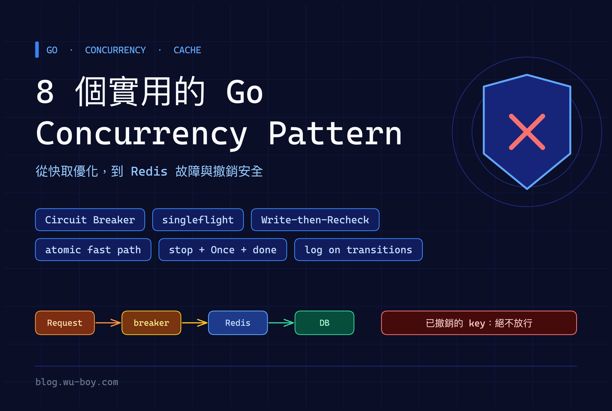
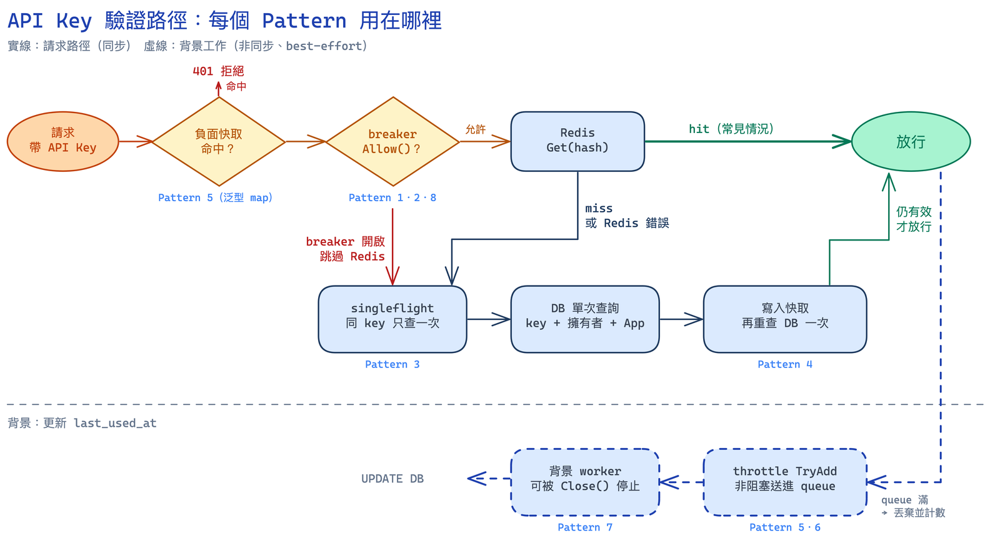
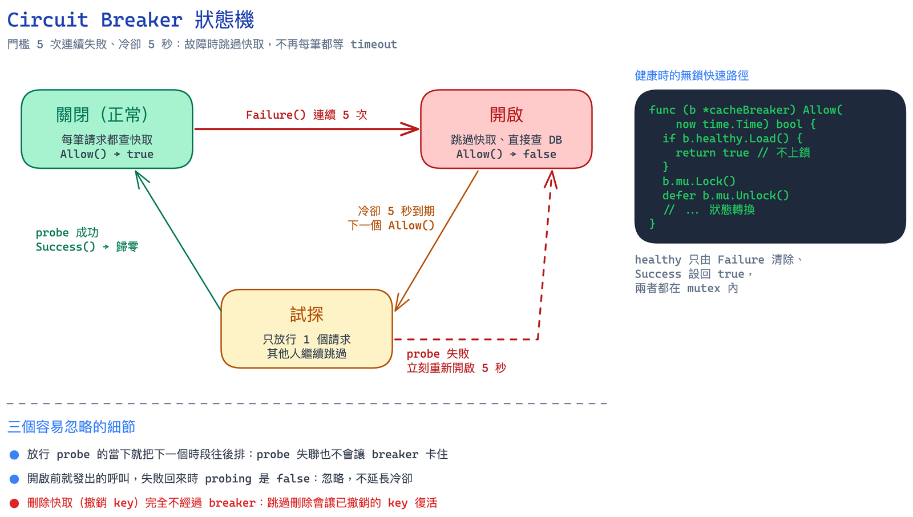
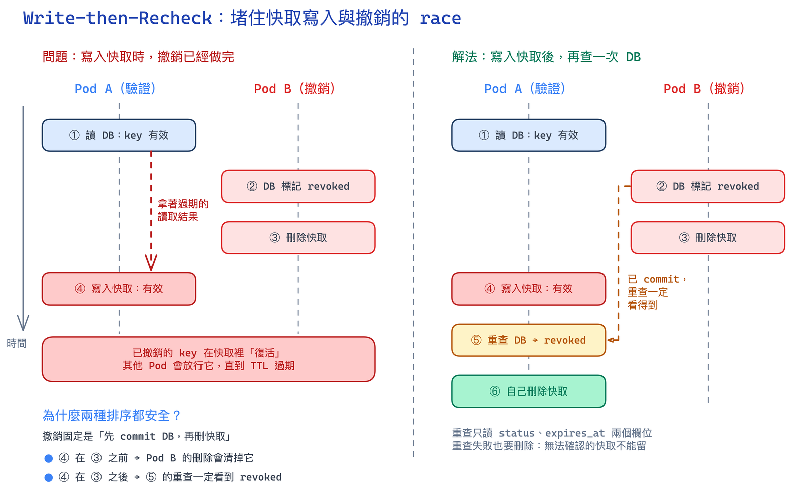
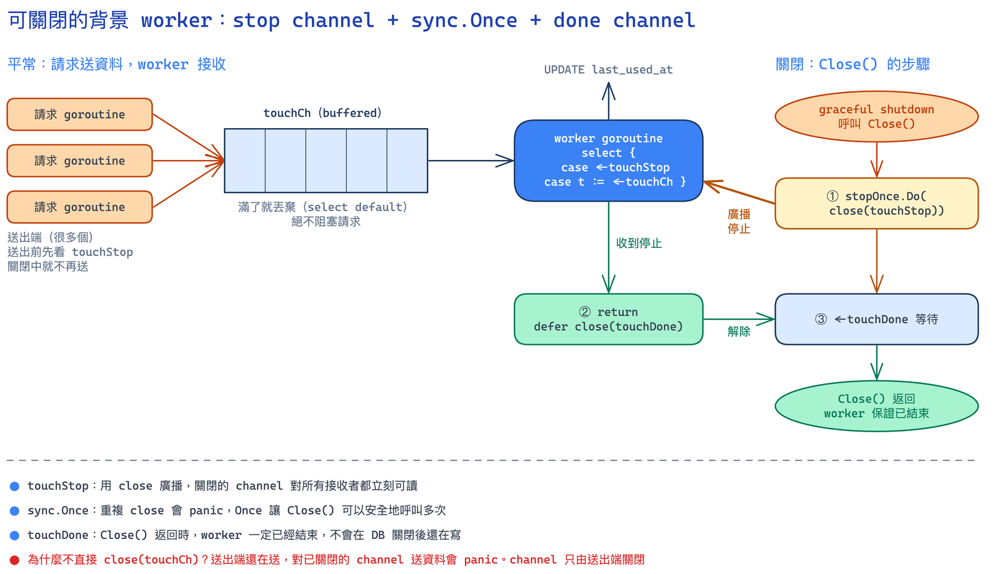

這篇文章整理自一個用 Go 撰寫的授權服務的效能改善。主題是 API Key 驗證快取：如何縮短 cache miss 的查詢路徑、在 Redis 故障時不拖垮每一筆請求，以及正確關閉背景 worker。程式碼取自實際專案，為了閱讀方便做了刪減，名稱也改成通用的寫法。

表面上這是 8 個獨立的 Go pattern，但它們服務同一個目標：**在快取降級、Redis 故障、服務關閉的各種情況下，守住「已撤銷的 key 絕對不能被放行」，同時把延遲和吞吐量換回來。** 文末有一段 Redis 故障時間線，把 8 個 pattern 串在同一條請求路徑上。

<!--more-->

## 背景：每一筆 API 請求都要驗證一把 Key

使用者拿 API Key 呼叫 API 時，伺服器要確認：

1. 這把 key 存在、沒被撤銷、沒過期
2. 擁有者帳號仍然啟用
3. 所屬的 App 仍然啟用，而且允許使用 API Key

這些資料分散在 `api_keys`、`users`、`apps` 三張表。每筆請求都查一次 DB 太貴，所以前面放了一層 Redis 快取。下圖是完整的驗證路徑，也標出本文每個 Pattern 用在哪裡。



### 貫穿全文的安全底線

在看 pattern 之前，先講清楚一條 invariant（不變條件）：**已撤銷的 key，絕對不能被放行。**

- **快取只是優化，正確性由 DB 決定。** Redis 故障或被跳過時，fallback 到 DB 結果一樣正確，所以快取的讀寫可以 fail-open（跳過它、直接查 DB）。
- **撤銷路徑不能 fail-open 到舊快取。** 撤銷後留在快取裡的「允許」紀錄，等於替已撤銷的 key 開了後門，所以刪除快取不能被任何降級機制擋掉（Pattern 1），快取寫入之後還要重查 DB（Pattern 4）。

後面的每個 pattern，都是在不破壞這條底線的前提下，換取延遲和吞吐量。

上一版實作的 code review 指出三個問題：

- cache miss 時要查好幾次 DB
- Redis 一旦故障，**每筆**請求都要先等 Redis timeout 才 fallback
- 背景更新 `last_used_at` 的 worker 沒辦法關閉，throttle 也有 race

文中程式碼用到幾個沒有貼出定義的常數，先在這裡列出它們在專案裡的實際值，後面看到時就不用再猜：

```go
const (
	breakerThreshold = 5                // 連續失敗幾次就開啟 breaker
	cooldown         = 5 * time.Second  // breaker 開啟後的冷卻時間
	ttl              = 30 * time.Second // 驗證快取的 TTL（預設 30 秒，上限 60 秒）
	fillTimeout      = 15 * time.Second // singleflight 共享查詢的上限
	interval         = time.Minute      // last_used_at 的節流間隔
	touchQueueSize   = 1024             // 背景更新 queue 的容量
)

// 快取查詢結果的標籤：hit、miss、bypass。
// bypass 表示這次沒有用到快取（breaker 開啟、被取消或快取故障），直接走 DB。
```

本文分成兩部分：

- **Pattern 1–4：快取與一致性**。故障時怎麼降級、熱點怎麼合併、快取和撤銷之間的 race 怎麼堵住。
- **Pattern 5–8：concurrency 與生命週期**。怎麼避免 check-then-act 的 race、背景工作怎麼不拖慢請求、goroutine 怎麼正確關閉，以及故障時的 log 和錯誤分類。

## 第一部分：快取與一致性（Pattern 1–4）

### Pattern 1：Circuit Breaker，讓故障的依賴快速失敗

快取只是加速用的。Redis 掛了，fallback 到 DB 結果一樣正確，問題只在**延遲**：每筆請求都卡在 Redis timeout。

Circuit breaker 的概念很簡單：連續失敗太多次，就暫時不要再呼叫它。



不需要引入第三方套件，100 行內就能寫完：

```go
type cacheBreaker struct {
	healthy   atomic.Bool // 見 Pattern 2
	mu        sync.Mutex
	threshold int
	cooldown  time.Duration
	failures  int
	open      bool
	openUntil time.Time // 下一次可以放行 probe 的時間
	probing   bool      // 已放行 probe，還沒回報
}

func (b *cacheBreaker) Allow(now time.Time) bool {
	if b.healthy.Load() {
		return true
	}
	b.mu.Lock()
	defer b.mu.Unlock()
	if !b.open {
		return true
	}
	if now.Before(b.openUntil) {
		return false
	}
	// 放行一個 probe，並且「立刻」把下一個 probe 的時間往後排
	b.probing = true
	b.openUntil = now.Add(b.cooldown)
	return true
}
```

#### 細節一：probe 名額在放行時就預約

`Allow` 放行 probe 時，馬上把 `openUntil` 往後推。如果寫成「等 probe 回報失敗才更新時間」，probe 請求一旦被取消（例如 client 斷線）、永遠沒有回報，breaker 就會一直以為有 probe 在跑，永遠不再放行。**在放行的當下就預約下一個時段**，即使 probe 失聯，冷卻結束後也會放行下一個。

#### 細節二：開啟前就發出的呼叫，失敗回來不延長冷卻

```go
func (b *cacheBreaker) Failure(now time.Time) (opened bool) {
	b.mu.Lock()
	defer b.mu.Unlock()
	b.healthy.Store(false)
	if b.open {
		if !b.probing {
			return false // breaker 開啟前就發出的呼叫：忽略
		}
		b.probing = false
		b.openUntil = now.Add(b.cooldown) // probe 失敗：重新開啟
		return true
	}
	b.failures++
	if b.failures < b.threshold {
		return false
	}
	b.open = true
	b.openUntil = now.Add(b.cooldown)
	return true
}
```

Redis 剛掛的時候，可能有上千個請求正在等 timeout。breaker 開啟後它們才陸續失敗回來，如果每一筆都把冷卻往後推，breaker 會一直開著。`!b.probing` 這個判斷就是把這些舊呼叫排除掉。

#### 細節三：只擋讀寫，不擋刪除

key 被撤銷時，要從快取刪掉「允許」的紀錄。**刪除絕對不能被 breaker 擋掉**：如果因為 breaker 開啟就略過刪除，Redis 恢復後，已撤銷的 key 還會被快取放行。這是安全問題，所以刪除快取的路徑完全不經過 breaker。

> 原則：breaker 保護的是「可以安全跳過」的操作。跳過了會造成錯誤結果的操作，不能交給 breaker 決定。

### Pattern 2：用 atomic 做無鎖快速路徑（Mutex + atomic.Bool）

加上 breaker 之後，每筆驗證都會呼叫 `Allow()` 和 `Success()`。在 Redis 健康的時候，這兩個方法原本都要取得同一把 mutex。高 RPS 下，所有請求都在搶一把根本不需要的鎖：狀態沒有任何改變。

解法是加一個 `atomic.Bool` 當作「完全健康」的旗標：

```go
func (b *cacheBreaker) Success() {
	if b.healthy.Load() {
		return // 健康時：不上鎖，直接返回
	}
	b.mu.Lock()
	defer b.mu.Unlock()
	b.failures = 0
	b.open = false
	b.probing = false
	b.openUntil = time.Time{}
	b.healthy.Store(true)
}
```

不變條件只有兩條，寫在 struct 的註解裡：

1. 只有 `Failure` 會把 `healthy` 設成 false
2. 只有 `Success` 會把它設回 true

而且兩者都在 mutex 內修改。這樣快速路徑只是**讀**一個 atomic，所有狀態轉換仍然受 mutex 保護。

那 race 呢？假設 `Success` 剛讀到 `healthy == true`，同時另一個 goroutine 執行了 `Failure`。結果是這次 Success 沒有把失敗次數歸零，效果等同於「Success 發生在 Failure 之前」。這是合法的排序之一，不會讓狀態錯亂。

> 原則：常見路徑不改狀態時，用 atomic 讀旗標跳過鎖，所有寫入仍然走鎖。關鍵是把「誰可以改旗標」的不變條件寫清楚。

### Pattern 3：singleflight + `context.WithoutCancel`，共享的工作不該被單一呼叫者取消

同一把熱門 key 同時有 100 個請求 cache miss，不需要查 100 次 DB。`golang.org/x/sync/singleflight` 會把同一個 key 的併發呼叫合併成一次（singleflight 的基本用法與熱點快取失效問題，可以參考之前的文章：[如何使用 singleflight 解決熱點快取失效問題](/2024/02/how-to-reslove-the-hotspot-invalid-using-singleflight/)）：

```go
func (s *KeyService) loadValidatedState(
	ctx context.Context,
	hash string,
) (keyFill, error) {
	if err := ctx.Err(); err != nil {
		return keyFill{}, err
	}
	resultCh := s.lookupGroup.DoChan(hash, func() (any, error) {
		fillCtx, cancel := context.WithTimeout(
			context.WithoutCancel(ctx), // 不繼承呼叫者的取消
			fillTimeout,                // 但有自己的上限
		)
		defer cancel()
		return s.fillValidatedState(fillCtx, hash)
	})

	select {
	case <-ctx.Done(): // 每個呼叫者仍然尊重自己的 context
		return keyFill{}, ctx.Err()
	case result := <-resultCh:
		// ...
	}
}
```

這裡有兩個容易踩的坑：

**坑一：用 `Do` 而不是 `DoChan`。** `Do` 會一直阻塞到結果出來，呼叫者的 context 被取消也沒辦法提早離開。`DoChan` 回傳 channel，可以和 `ctx.Done()` 一起 `select`。

**坑二：直接把呼叫者的 ctx 傳進共享函式。** 共享的 DB 查詢會用第一個進來的請求（leader）的 ctx 執行。如果這個使用者斷線，查詢被取消，**另外 99 個等待者全部一起失敗**。

Go 1.21 加入的 `context.WithoutCancel` 剛好解決這個問題：保留 ctx 裡的 value（trace ID、logger 等），但切斷取消訊號。再用 `WithTimeout` 給它一個獨立的上限，避免共享工作永遠跑下去。

另外要注意 singleflight 的範圍：它只在**單一 process 內**合併請求。多個 Pod 同時 miss 同一把 key，每個 Pod 仍然會各查一次 DB。它解決的是 process 內的重複查詢，不是跨 Pod 的協調，這個限制在文末的「還沒解決的問題」會再回來。

> 原則：共享的工作要和任何單一呼叫者的生命週期脫鉤，但要有自己的 timeout；每個呼叫者各自決定要不要繼續等。

### Pattern 4：寫入後重查（Write-then-Recheck），堵住撤銷的 race

這是整個改動裡最需要想清楚的地方。考慮兩個 Pod 同時在做兩件事：



左半邊是問題：Pod A 讀 DB 時 key 還有效，等它寫入 Redis 時，key 已經被撤銷，而且 Pod B 的刪除早就做完了。結果快取裡留著一筆已撤銷 key 的「允許」，直到 TTL 過期。

右半邊是解法：**寫入快取之後，再讀一次 DB**。

```go
func (s *KeyService) cacheValidatedState(
	ctx context.Context,
	hash string,
	state *ValidatedKeyState,
) string {
	if err := s.cache.Set(ctx, hash, *state, ttl); err != nil {
		s.recordCacheFailure(ctx, "set", err)
		return ""
	}

	fresh, err := s.store.GetKeyLifecycleByHash(ctx, hash)
	switch {
	case err == nil && fresh.Status == StatusActive &&
		!fresh.IsExpiredAt(time.Now()):
		return "" // 仍然有效
	case err == nil && fresh.Status == StatusRevoked:
		s.evictCache(ctx, hash)
		return "revoked"
	// ... expired、not found 同理
	default:
		// 這次放行所依據的 DB 讀取本身已經是權威結果，所以仍然放行；
		// 但無法驗證的快取，不能比這次失敗的檢查活得更久
		s.evictCache(ctx, hash)
		return ""
	}
}
```

為什麼這樣就安全？撤銷一定是**先 commit DB，再刪快取**。所以 Pod A 的寫入只有兩種情況：

- **寫入在刪除之前**：Pod B 的刪除會把它清掉
- **寫入在刪除之後**：DB 早就 commit 了，Pod A 的重查一定會看到 `revoked`，自己把快取刪掉

兩種排序都不會讓已撤銷的 key **一直**留在快取裡直到 TTL 過期。

程式碼最後的 `default` 分支也值得說明：重查本身失敗（例如 DB 暫時連不上）時，這個請求仍然放行。原因是放行的依據，是前一步從 DB 讀到的「有效」結果，它本身就是權威的。但剛寫進快取的那筆 entry 已經無法確認是否仍然有效，所以要把它清掉，不能讓它比這次失敗的檢查活得更久。

#### 這個保證的邊界

這個做法保證的是「復活的 key 會被自己清掉」，不是「完全沒有空窗」。有三點要清楚：

1. **仍有一段短暫空窗。** 從 ④ 寫入快取到 ⑥ 清除之前，其他 Pod 的請求可能讀到這筆過期的「允許」。空窗被限制在一次重查 DB 的時間內，不再是整個 TTL。如果業務上連這段都不能容忍，就要改成撤銷時即時失效的機制，或是縮短快取 TTL。
2. **重查必須讀到最新資料。** 重查要讀 primary，不能讀有 replication lag 的 read replica。如果 replica 還沒同步到 `revoked`，重查會看到舊狀態，上面的推論就不成立。
3. **撤銷時刪快取失敗，只能靠 TTL 收斂。** 刪除不經過 breaker，但 Redis 真的連不上時，刪除本身還是會失敗。這時已撤銷的 key 最長會被放行到 TTL 過期，所以 TTL 的長短就是這個安全底線的最後一道上限。在這個專案裡，TTL 預設 30 秒、上限 60 秒；撤銷時刪除快取會重試 2 次，仍然失敗才記 ERROR，並依賴 TTL 收斂。

#### 重查只讀需要的欄位

重查只是要確認「這把 key 還能不能用」，所以另外寫了一個只讀 `status` 和 `expires_at` 的查詢，不撈整筆資料：

```go
type KeyLifecycle struct {
	Status    string    `gorm:"column:status"`
	ExpiresAt time.Time `gorm:"column:expires_at"`
}
```

這裡用一個獨立的小 struct，而不是回傳只填了兩個欄位的完整 model。這樣呼叫端不會誤用那些沒被填值的欄位。

> 原則：「先寫 DB 再刪快取」配上「先寫快取再重查 DB」，兩邊各自保證一個方向，合起來把空窗從「整個 TTL」縮小到「一次重查的時間」。前提是重查讀的是最新資料。

## 第二部分：Concurrency 與生命週期（Pattern 5–8）

這四個 pattern 乍看和快取無關，其實撐住的是同一條請求路徑：節流、背景寫入、關閉、故障時的 log。讀完之後，文末的「Redis 故障時間線」會把它們和前四個 pattern 串在一起。

### Pattern 5：原子的 Check-and-Set，消除 TOCTOU

`last_used_at` 只是顯示用的資料，每把 key 每段時間最多更新一次就夠了。原本的寫法是：

```go
// 有 race 的寫法
if s.touchThrottle.Has(key.ID, now) {
	return
}
s.touchThrottle.Add(key.ID, now.Add(interval))
// 送出更新...
```

`Has` 和 `Add` 各自有加鎖，但**兩次呼叫之間沒有**。兩個 goroutine 可能同時通過 `Has`，然後都送出更新。這就是經典的 TOCTOU（Time-of-check to time-of-use）。

修法是把檢查和寫入放進同一個臨界區段：

```go
// TryAdd 只有在 key 不存在或已過期時才寫入，並回報是否寫入成功。
func (m *boundedTTLMap[V]) TryAdd(key string, value V, now, expiresAt time.Time) bool {
	m.mu.Lock()
	defer m.mu.Unlock()

	if existing, ok := m.entries[key]; ok && now.Before(existing.expiresAt) {
		return false
	}
	m.setLocked(key, value, expiresAt)
	return true
}
```

呼叫端變成一行：

```go
if !s.touchThrottle.TryAdd(key.ID, now, now.Add(interval)) {
	return
}
```

這也是 generics 的好例子。`boundedTTLMap[V]` 是一個有容量上限、會過期的 map：負面快取（記住不存在或已撤銷的 key）需要存值，throttle 只需要知道「有沒有」。兩者共用同一份實作，`boundedTTLSet` 只是 `boundedTTLMap[struct{}]` 的薄包裝。

另外注意 `setLocked` 這個命名慣例：`Locked` 後綴代表「呼叫者必須已經持有鎖」。`Add` 和 `TryAdd` 共用這段寫入邏輯，又不會重複上鎖。

> 原則：「先檢查再動作」要成立，兩步必須在同一把鎖內完成。提供一個 `TryXxx` 方法，比讓呼叫端自己組合 `Has` + `Add` 安全得多。

### Pattern 6：非阻塞送出，失敗時回滾

`last_used_at` 的更新會丟到背景 channel，由 worker 寫 DB。請求路徑上**絕對不能**因為 queue 滿了而卡住：

```go
func (s *KeyService) touchLastUsed(key *APIKey, now time.Time) {
	select {
	case <-s.touchStop: // 已經在關閉：不要再送
		return
	default:
	}
	if !s.touchThrottle.TryAdd(key.ID, now, now.Add(interval)) {
		return
	}
	select {
	case s.touchCh <- touchRequest{keyID: key.ID, now: now}:
	default:
		// queue 滿了：丟棄，並撤回 throttle，讓下一次請求還有機會更新
		s.touchThrottle.Delete(key.ID)
		s.metrics.RecordTouchDropped()
		return
	}
	setTouchQueueLength(len(s.touchCh))
	key.LastUsedAt = &now
}
```

三個重點：

1. **`select` + `default`** 讓送出變成非阻塞：queue 滿了就丟，不會拖慢請求。
2. **丟棄時要回滾 throttle**。不然這把 key 在整個 interval 內都不會再嘗試更新，等於白白漏掉一次。
3. **丟棄要計數**（例如 `touch_dropped_total`）。best-effort 不代表可以默默丟資料，要讓維運看得到。

> 原則：best-effort 的背景工作用非阻塞送出；丟棄時把先前佔用的資源還回去，並且留下指標。

### Pattern 7：可關閉的背景 Worker，stop channel + `sync.Once` + done channel

原本的 worker 是 `for touch := range s.touchCh`，一旦啟動就沒辦法停。這次改成標準的三件組：



```go
type KeyService struct {
	touchCh       chan touchRequest
	touchStop     chan struct{} // 通知 worker 停止
	touchDone     chan struct{} // worker 確實結束了
	touchStopOnce sync.Once     // 讓 Close 可以重複呼叫
}

func (s *KeyService) touchWorker() {
	defer close(s.touchDone)
	for {
		select {
		case <-s.touchStop:
			return
		case touch := <-s.touchCh:
			setTouchQueueLength(len(s.touchCh))
			s.writeTouch(touch)
		}
	}
}

// Close 停止 worker。queue 裡剩下的更新不會寫入：last_used_at 只是顯示用資料。
func (s *KeyService) Close() {
	s.touchStopOnce.Do(func() { close(s.touchStop) })
	<-s.touchDone
}
```

三個元件各有用途：

| 元件 | 用途 |
|---|---|
| `touchStop` | 用 `close` 廣播停止訊號。關閉的 channel 對所有接收者都立刻可讀，而且不會阻塞送出端 |
| `sync.Once` | 對已關閉的 channel 再 `close` 會 panic，`Once` 讓 `Close()` 可以重複呼叫 |
| `touchDone` | `Close()` 返回時，保證 worker 真的已經結束，不會在 DB 關閉後還在寫 |

為什麼不直接 `close(touchCh)`？因為請求路徑上還有 goroutine 在**送**資料到 `touchCh`，對已關閉的 channel 送資料會 panic。原則是：**channel 只由送出端關閉**；接收端要停，就用另一個 stop channel。

**為什麼不用 `context.Context` 取消 worker？** 用 ctx 也能通知 worker 停止，很多專案會這樣寫。這裡選 stop + done channel，是因為 `Close()` 需要的是**同步**語意：呼叫者要等到 worker 真的結束才能繼續關 DB。ctx 的取消只負責「通知」，不會告訴你對方結束了，仍然需要另一個 done channel 或 `WaitGroup` 來等待。既然兩個都要，直接用 stop channel 加 done channel，語意更直接。如果 worker 內部的 DB 呼叫需要被中途打斷，再把 ctx 傳進 `writeTouch` 即可，兩種做法可以並存。

最後把 `Close` 註冊到 graceful shutdown：

```go
func addKeyServiceShutdownJob(m *graceful.Manager, svc interface{ Close() }) {
	m.AddShutdownJob(func() error {
		svc.Close()
		return nil
	})
}
```

參數型別用匿名介面 `interface{ Close() }`，不需要為了這一個函式另外定義具名介面，測試時也很好替換。

> 原則：有 goroutine 就要有停止它的方法。stop channel 負責廣播、`sync.Once` 防止重複 close、done channel 確認結束，三者缺一不可。

### Pattern 8：故障時的 Log 與錯誤分類

Redis 故障時，最容易被忽略的副作用是 **log 洪水**：每筆請求一條 WARN，幾秒內就是上萬行。真正重要的訊息被淹沒，log 系統本身也可能撐不住。

```go
func (s *KeyService) recordCacheFailure(ctx context.Context, op string, err error) {
	if s.cacheBreaker.Failure(time.Now()) {
		// 狀態轉換：只在 breaker 剛開啟時記一次 ERROR
		slog.ErrorContext(ctx, "validation cache failing; bypassing it temporarily",
			"operation", op, "cooldown", cooldown, "error", err)
		return
	}
	if s.cacheBreaker.IsOpen() {
		return // 開啟後才回來的失敗：已經記過了，保持安靜
	}
	slog.WarnContext(ctx, "validation cache operation failed; falling back to database",
		"operation", op, "error", err)
}
```

讓 `Failure()` 回傳「這次是否剛轉換狀態」，呼叫端就能**只在狀態轉換時記 log**。

另一個常見錯誤是把所有錯誤都當成「後端故障」：

```go
case errors.Is(ctx.Err(), context.Canceled):
	// 呼叫者自己離開了（例如 client 斷線），這和 Redis 健不健康無關，
	// 不能算進 breaker 的失敗次數。
	return nil, cacheBypass // 標籤 bypass：這次沒用到快取，直接走 DB
```

如果把 client 斷線也算成失敗，一波使用者同時關掉瀏覽器，breaker 就會被誤觸發。注意這裡檢查的是**呼叫者的** `ctx.Err()`，而不是回傳的 `err`：底層用 `%v` 包裝錯誤，`errors.Is(err, context.Canceled)` 不一定判斷得出來。

> 原則：log 只記狀態轉換，不記每一次事件；錯誤要分類，只有真正反映依賴健康狀況的錯誤才算進 breaker。

## 把 8 個 Pattern 串起來：一次 Redis 故障的時間線

前面是一個一個講，實際上它們是在同一條請求路徑上接力。下面用一次 Redis 故障，從頭到尾看它們怎麼分工（假設門檻 5 次連續失敗、冷卻 5 秒）：

| 階段 | 發生什麼 | 用到的 Pattern |
|---|---|---|
| **① 正常** | breaker 健康，`Allow()` 只讀一個 atomic，不上鎖；命中快取直接放行。放行後 `touchLastUsed` 用 `TryAdd` 節流、非阻塞送進 queue，由背景 worker 寫 DB | 2 快速路徑、5 `TryAdd`、6 非阻塞送出、7 worker |
| **② Redis 開始 timeout** | 每筆請求都卡在 timeout，`Failure()` 開始累計。miss 的請求由 singleflight 合併，同一把 key 只查一次 DB。client 中途斷線不算失敗，不會誤推進 breaker | 3 singleflight、8 錯誤分類 |
| **③ 連續失敗達 5 次** | breaker 開啟，**只記一次** ERROR log。之後 `Allow()` 回傳 false，請求直接查 DB，延遲回到 DB 的水準。開啟前就發出的呼叫陸續失敗回來，被忽略，不延長冷卻也不再寫 log | 1 breaker、8 只記狀態轉換 |
| **④ 開啟期間** | 熱門 key 仍由 singleflight 合併。有 key 被撤銷時，刪除快取**不經過 breaker**，Redis 若仍連不上就刪除失敗，只能靠 TTL 收斂。`last_used_at` 更新照常走背景，queue 滿了就丟棄、回滾 throttle、計數 | 1 刪除不被擋、3、6 |
| **⑤ 冷卻 5 秒到期** | `Allow()` 放行一個 probe，**同時**預約下一個時段。probe 失敗就再開 5 秒；成功則 `Success()` 歸零，`healthy` 設回 true，回到無鎖快速路徑 | 1 probe、2 快速路徑 |
| **⑥ 恢復後回填** | miss 的請求寫入快取後，**再查一次 DB**。如果這把 key 在期間被撤銷，重查會看到 `revoked` 並自己清掉，不會讓過期的「允許」留到 TTL 結束 | 4 Write-then-Recheck |
| **部署或關閉時** | graceful shutdown 呼叫 `Close()`：廣播停止、等 worker 確實結束，之後才關 DB | 7 stop + Once + done |

這張表也說明了為什麼 Pattern 5 到 8 不是「附帶的小技巧」：沒有 Pattern 6，queue 滿了會拖慢放行的請求；沒有 Pattern 7，關閉時 worker 可能還在寫已經關掉的 DB；沒有 Pattern 8，Redis 故障的第一個 5 秒就會產生上萬行 log，還可能被 client 斷線誤觸 breaker。它們守的是同一件事：**故障和關閉的時候，系統仍然正確、仍然撐得住。**

## 還沒解決的問題

breaker 解決了「Redis 故障時的延遲」，但沒有解決「Redis 故障時 DB 要扛全部流量」。singleflight 只合併**同一把** key；大量**不同** key 同時 miss 時，DB 的併發只受連線池上限保護，超過的請求會一直排隊到 fill timeout。

下一步是在 singleflight leader 內加一個全域 semaphore，限制每個 process 同時進行的 fill 數量，拿不到名額就立即失敗，不要排隊。這會是另一篇文章的主題。

## 總結

| 分類 | Pattern | 解決的問題 |
|---|---|---|
| 快取與一致性 | 1. Circuit Breaker | 依賴故障時，每筆請求都要等 timeout |
| | 2. atomic 快速路徑 | 健康時所有請求搶同一把鎖 |
| | 3. singleflight + `WithoutCancel` | 熱門 key 重複查詢；leader 斷線拖垮所有等待者 |
| | 4. Write-then-Recheck | 快取寫入和撤銷之間的 race |
| Concurrency 與生命週期 | 5. 原子 Check-and-Set | `Has` + `Add` 的 TOCTOU |
| | 6. 非阻塞送出 + 回滾 | 背景 queue 滿時拖慢請求 |
| | 7. stop + Once + done | 背景 goroutine 無法關閉 |
| | 8. 狀態轉換 log + 錯誤分類 | 故障時 log 洪水；client 斷線誤觸 breaker |

這些 pattern 單獨看都不複雜，難的是在同一條請求路徑上把它們組合起來，同時守住「已撤銷的 key 絕對不能被放行」這條安全底線。
